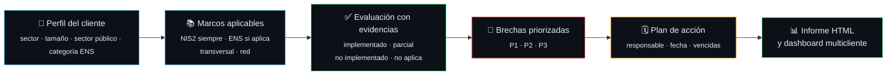

<div align="center">

<a href="https://pedri77.github.io/smc-cinematica/"></a>

# Security Manager Control

**Todo el perímetro, en una sola pantalla.**

Qué exige la normativa a cada cliente, qué tiene ya implantado, con qué evidencias y qué falta, priorizado.<br>
NIS2 · ENS · ISO 27001 · SOC · verticales · tecnologías · vulnerabilidades por protocolo · mapa de red. En local, sin servidor y sin que los datos salgan de tu equipo.

[](CHANGELOG.md)
[](tests/)
[](pyproject.toml)
[](pyproject.toml)

[](soc/verticals.yaml)
[](vulnerabilities/protocols.yaml)
[](resources/rss.yaml)
[](frameworks/nis2/controls.yaml)
[](frameworks/ens/controls.yaml)
[](frameworks/transversal/controls.yaml)
[](network/controls.yaml)
[](soc/use-cases/catalog.yaml)
[](docs/adr/ADR-001-catalogos-como-datos-y-datos-de-cliente-fuera-del-repo.md)

[**Ver la web**](https://pedri77.github.io/smc-cinematica/) · [Empezar en 1 minuto](#empezar-en-1-minuto) · [Comandos](#comandos) · [Ecosistema](#ecosistema) · [PRD](docs/prd/PRD-SMC-001-v1.md) · [Changelog](CHANGELOG.md)

</div>

---

## El problema

El Security Manager, el CISO o el consultor GRC que lleva varios clientes no tiene una vista única que responda a cuatro preguntas: **¿qué me exige la normativa, qué tengo, con qué evidencia y qué me falta?** La respuesta está repartida entre hojas de cálculo, informes de auditoría, consolas de seguridad y contratos con proveedores.

SMC lo junta en un único sitio: catálogos de controles versionados como datos, una evaluación por cliente y un CLI que calcula el cumplimiento, cruza marcos, prioriza brechas y entrega el informe.

<p align="center">
  
</p>

## Cómo funciona



<p align="center">
  
</p>

1. **Alcance.** Copia `assessments/assessment.template.yaml` y rellena el perfil del cliente.
2. **Marcos.** NIS2 siempre; ENS si `sector_publico` o `proveedor_sector_publico`, filtrado por su categoría (BÁSICA, MEDIA, ALTA); transversal y red siempre.
3. **Evaluación.** Estado de cada control y sus evidencias. Un control `implementado` sin evidencia sale como aviso: evidencia antes que checkbox.
4. **Brechas.** `smc gap` calcula el cumplimiento por marco y ordena lo que falta por prioridad.
5. **Plan.** `plan_accion:` en la evaluación y `smc plan` para ver acciones vencidas y brechas P1 sin acción.
6. **Entrega.** `smc report` para dirección (HTML imprimible a PDF) y `smc dashboard` para todos tus clientes.

## Tres marcos, una sola rejilla

Evalúa una vez y reutiliza. El mapeo `mappings/nis2-ens-iso27001.csv` cruza cada control NIS2 con sus medidas ENS y los controles del Anexo A de ISO 27001:2022. Si un control no está evaluado pero su equivalente sí, el informe lo marca como **heredado** para que no se te escape.

<p align="center">
  
</p>

| Bloque | Base | Cuándo aplica |
|---|---|---|
| **NIS2** | Directiva (UE) 2022/2555, art. 20, 21 y 23 + Reglamento de Ejecución (UE) 2024/2690 | Línea base para **todos** los clientes (entidad esencial, importante o como referencia voluntaria) |
| **ENS** | Real Decreto 311/2022, Anexo II (73 medidas) con categoría mínima y refuerzos | Sector público y sus proveedores |
| **Transversal** | ISO/IEC 27001:2022, RGPD/LOPDGDD, DORA, CIS Controls v8 | Cualquier organización |
| **Red** | Módulo propio | Segmentación, perímetro, acceso remoto, DNS, Wi‑Fi, OT, monitorización |
| **Normativa** | NIS2 completa + CCN-CERT | Directiva, RE 2024/2690, guía de ENISA, anteproyecto español; guías CCN-STIC, BP e ITS enlazadas a controles (`smc refs`) |

### Priorización

```
prioridad = 50·estado + 30·criticidad + 10·entidad + 10·cobertura multinorma
P1 ≥ 75 · P2 ≥ 40 · P3 resto
```

Estado: no implementado 1, sin evaluar 0,75, parcial 0,5. Entidad: esencial 1, importante 0,5, otra 0. Un no implementado de criticidad alta en una entidad esencial es P1; uno de criticidad media en una entidad importante sin cobertura multinorma, P2.

## Toda la sala, no solo el cumplimiento

<p align="center">
  
</p>

| Módulo | Qué mide | Dónde |
|---|---|---|
| 🛰️ **SOC** | SLA por severidad y tier, MTTD, MTTA, MTTC, MTTR | `smc soc` |
| 🎯 **MITRE ATT&CK** | Cobertura y madurez (niveles 1-5) de 8 casos de uso con playbook; capa para ATT&CK Navigator | `smc mitre`, `smc mitre --navigator` |
| 🧩 **Verticales** | 20 verticales (EDR/XDR, IAM, red, firewall, SASE, ZTNA, capas OSI, Threat Hunting, MDM, puesto de usuario, correo, cloud, datos, copias, OT…) con madurez 0-5 o «no evaluable» con motivo, clasificadas por medida NIS2 21.2 | `smc verticals` |
| 🔑 **Tecnologías** | Licencias, fin de soporte, certificados, sobredespliegue; evaluación de cada producto y estado de sus reglas (any-any, sin uso, revisión caducada) | `smc expiring`, `smc tech` |
| 💶 **Suscripciones** | Coste, renovaciones a 90 días y uso por debajo del 70 % de lo contratado | `smc subs` |
| 🩹 **Vulnerabilidades** | CVEs con SLA de remediación (KEV, EPSS, CVSS) y playbooks por tecnología y caso de uso | `smc vulns` |
| 🌐 **Protocolos** | 28 protocolos por capa OSI con sus debilidades típicas y 8 fuentes oficiales (NVD, ENISA, CISA KEV…) | `smc protocols` |
| 📰 **RSS** | 17 feeds de seguridad, 13 verificados, exportables a OPML | `smc rss` |
| 🗺️ **Mapa de red** | Dispositivos por zona y capa OSI con semáforo; JSON `smc-mapa/1` para un visor 3D | `smc mapa` |
| ⚖️ **Normativa** | Base legal y guías CCN-CERT de cualquier control | `smc refs` |

## Lo que entregas

<table>
  <tr>
    <td width="50%"></td>
    <td width="50%"></td>
  </tr>
  <tr>
    <td><b>Informe HTML</b> para dirección (responsabilidad NIS2 art. 20): resumen ejecutivo, brechas P1, plan de acción y avisos. Un solo fichero, imprimible a PDF.</td>
    <td><b>Dashboard multicliente</b>: cumplimiento por marco, brechas P1, acciones vencidas y semáforo por cliente. Estático, sin servidor.</td>
  </tr>
</table>

<sub>Capturas generadas con los dos ejemplos ficticios del repositorio. Salen en rojo porque la mayoría de sus controles están sin evaluar, que puntúan como no cumplidos.</sub>

## Empezar en 1 minuto

```bash
git clone https://github.com/pedri77/security-manager-control.git
cd security-manager-control
pip install -e .

smc validate                                                     # catálogos OK
smc gap assessments/examples/ejemplo-ayuntamiento.yaml           # brechas en Markdown
smc report assessments/examples/ejemplo-ayuntamiento.yaml -o /tmp/informe.html
smc dashboard assessments/examples -o /tmp/panel                 # abre /tmp/panel/index.html
```

## Comandos

```bash
smc validate                                              # valida catálogos
smc list                                                  # controles por marco
smc gap <evaluación.yaml> [-o informe.md] [--hoy AAAA-MM-DD]
smc plan <evaluación.yaml> [--hoy AAAA-MM-DD]             # vencidas y brechas sin acción
smc report <evaluación.yaml> -o informe.html [--hoy AAAA-MM-DD]
smc dashboard <dir_evaluaciones> -o <dir_salida> [--hoy AAAA-MM-DD]
smc soc soc/incidents.template.csv                        # MTTD/MTTA/MTTC/MTTR y % SLA
smc mitre [--navigator [-o capa.json]] [--hoy AAAA-MM-DD] # cobertura y madurez ATT&CK; capa Navigator
smc verticals <evaluación.yaml>                           # madurez por vertical y por medida NIS2
smc tech technologies/registry.template.yaml [--hoy AAAA-MM-DD] [--days 180]   # evaluación y estado de reglas
smc subs technologies/registry.template.yaml [--hoy AAAA-MM-DD] [--days 90]    # suscripciones y renovaciones
smc expiring technologies/registry.template.yaml --days 90
smc vulns vulnerabilities/tracker.template.csv            # CVEs abiertos y fuera de SLA
smc protocols [ID]                                        # protocolos por capa OSI y fuentes oficiales
smc rss [--opml [-o feeds.opml]]                          # listado de feeds y export OPML
smc mapa technologies/registry.template.yaml [--inventario resources/internal/inventory.template.yaml] \
        [--tracker <tracker.csv>] [--evaluacion <evaluación.yaml>] [--hoy AAAA-MM-DD] [-o mapa.json]
smc refs NIS2-21.2.b                                      # normativa y guías CCN-CERT
smc --version
```

Estados de control: `implementado` (1,0) · `parcial` (0,5) · `no_implementado` (0) · `no_aplica` (excluido) · sin evaluar (0, listado aparte; un estado no válido se trata igual, con aviso). Una acción `bloqueada` o `hecha` no cubre una brecha abierta.

## Ecosistema

SMC enlaza con material público del mismo autor. Solo páginas públicas y repos públicos; la lista vive en [`resources/ecosistema.yaml`](resources/ecosistema.yaml) y `smc validate` la comprueba.

| Tema | Recurso |
|---|---|
| EDR/XDR | [EDR/XDR visual](https://pedri77.github.io/edr-visual-app/) |
| SASE | [SASE visual](https://pedri77.github.io/sase-visual-app/) |
| Firewalls | [Firewalls básicos](https://pedri77.github.io/Basic_Firewalls/) |
| Capas OSI | [Protección por capas OSI](https://pedri77.github.io/Basicos_Proteccion_Capas_OSI/) · [Modelo OSI](https://pedri77.github.io/modelo_OSI/) |
| ICS/OT | [ICS/OT security studio](https://pedri77.github.io/ics-security-studio/) |
| WAF | [WAF forge](https://pedri77.github.io/wafforge/) |
| Correo | [Correo básico](https://pedri77.github.io/Basicos_email/) |
| Inteligencia de amenazas | [KEV dashboard](https://github.com/pedri77/kev_dash_project) (repo) · [Threat intelligence feeds](https://github.com/pedri77/threat-intelligence-feeds) (repo) |

**Proyectos pendientes** (sin URL hasta que existan):

- Evaluación de productos **ZTNA**.
- Repositorio de **vulnerabilidades por capa OSI**.
- **Visor 3D del mapa de red**, a partir de la skill [teardown](https://github.com/elvarofficial/teardown) (MIT, sobre [claude-motion](https://github.com/whaleyxbt/claude-motion), MIT). El contrato de datos ya está: `smc mapa` y [`docs/mapa-3d.md`](docs/mapa-3d.md).

## Los datos del cliente no salen de tu equipo

<p align="center">
  
</p>

- **Datos de clientes fuera del repositorio** ([ADR-001](docs/adr/ADR-001-catalogos-como-datos-y-datos-de-cliente-fuera-del-repo.md)). `.gitignore` excluye evaluaciones reales, `*.html` y `dashboard/` como red de seguridad. Escribe las salidas fuera del repo.
- **Ejecución local u on-prem en la UE.** Sin llamadas de red, sin telemetría.
- **Informes autocontenidos** ([ADR-002](docs/adr/ADR-002-informes-html-y-dashboard-estatico.md)): CSS en línea, sin JavaScript, fuentes ni recursos externos. Todo texto de la evaluación se escapa.
- **Catálogos como datos.** Actualizar un marco es un PR sobre YAML, revisable sin tocar código. Los IDs (`NIS2-21.2.a`, `ENS-op.acc.6`, `TRV-RGPD-01`, `NET-SEG-01`) son contrato: no se renombran, se deprecan.

## Estructura

```
security-manager-control/
├── frameworks/          nis2 · ens · transversal (controls.yaml)
├── mappings/            nis2-ens-iso27001.csv
├── network/             módulo de red
├── normativa/           NIS2 completa · guías CCN-CERT
├── soc/                 SLA · métricas · 20 verticales · casos de uso MITRE
├── technologies/        registro de tecnologías
├── vulnerabilities/     política · tracker · 28 protocolos · playbooks
├── resources/           inventario interno y de terceros · RSS · ecosistema
├── assessments/         plantilla + ejemplos ficticios
├── smc/                 CLI (gap, plan, report, dashboard, soc, mitre, mapa…)
├── tests/               222 tests
└── docs/                PRD · ADR · plan del enjambre · imágenes
```

## Hoja de ruta

| Versión | Entregable | Estado |
|---|---|---|
| v0.1 | Catálogos YAML, plantillas, `smc gap` | ✅ |
| v0.2 | Aplicabilidad ENS por categoría, priorización por riesgo, mapeos completos | ✅ |
| v0.3 | Informe HTML/PDF y plan de acción | ✅ |
| v0.4 | Dashboard multicliente (estático, local) | ✅ |
| v0.5 | 20 verticales (Threat Hunting, MDM, puesto, firewall, SASE, ZTNA, capas OSI), evaluación de tecnologías, reglas y suscripciones, 28 protocolos con fuentes oficiales, madurez MITRE con 8 playbooks y capa Navigator, 17 feeds RSS, ecosistema y mapa de red (`smc mapa`) | ✅ |
| v0.6 | Visor 3D del mapa desde teardown, contraste del Anexo II del ENS con el BOE, conectores de evidencias, ingesta NVD/KEV/EPSS, cumplimiento por dominio | 📋 |

## Limitaciones conocidas

> [!WARNING]
> **ENS pendiente de contrastar.** 39 de las 73 medidas llevan `verificar: true`: su categoría mínima y sus refuerzos se rellenaron sin la tabla del Anexo II del RD 311/2022 delante. Los informes las marcan con «(verificar)» y avisan en el resumen. Hay además una posible discrepancia de ID (`op.exp.10` / `op.exp.11`) y de numeración en `mp.info`.

- Las verticales nuevas (mapeo NIS2, controles), la madurez de los casos de uso y los protocolos son juicio inicial sobre datos de muestra, sin fuente normativa ni SOC real. La capa OSI de TLS y BGP es una convención discutible.
- Las criticidades NIS2 son un juicio inicial sin fuente normativa: afectan al orden de prioridad, no al cumplimiento.
- «Sin evaluar» puntúa como no cumplido: una evaluación incompleta sale en rojo. Es lo esperado; el informe separa las brechas evaluadas de las pendientes.
- La ley española de transposición de NIS2 (*Anteproyecto de Ley de Coordinación y Gobernanza de la Ciberseguridad*) sigue en tramitación: revisar el catálogo cuando se publique en el BOE.

---

<div align="center">

<a href="https://pedri77.github.io/smc-cinematica/"></a>

<sub>Hecho por <a href="https://github.com/pedri77">pedri77</a>. Construido con un enjambre de agentes: el plan y los informes de cada tarea están en <a href="docs/plan/">docs/plan</a>.</sub>

</div>
