<div align="center">

<a href="https://pedri77.github.io/smc-cinematica/">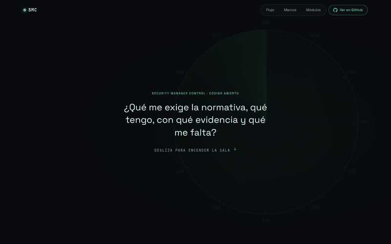</a>

# Security Manager Control

**Todo el perímetro, en una sola pantalla.**

Qué exige la normativa a cada cliente, qué tiene ya implantado, con qué evidencias y qué falta, priorizado.<br>
NIS2 · ENS · ISO 27001 · SOC · verticales · tecnologías · vulnerabilidades por protocolo · mapa de red · pentest y purple team · IA (RIA) · PMO · evolución entre evaluaciones · salida para auditor. En local, sin servidor y sin que los datos salgan de tu equipo.

[](CHANGELOG.md)
[](https://github.com/pedri77/security-manager-control/actions/workflows/tests.yml)
[](tests/)
[](pyproject.toml)
[](pyproject.toml)

[](soc/verticals.yaml)
[](vulnerabilities/protocols.yaml)
[](resources/rss.yaml)
[](frameworks/)
[](frameworks/ai-act/obligaciones.yaml)
[](frameworks/nis2/controls.yaml)
[](frameworks/ens/controls.yaml)
[](frameworks/transversal/controls.yaml)
[](network/controls.yaml)
[](soc/use-cases/catalog.yaml)
[](docs/adr/ADR-001-catalogos-como-datos-y-datos-de-cliente-fuera-del-repo.md)

[**Ver la web**](https://pedri77.github.io/smc-cinematica/) · [Empezar en 1 minuto](#empezar-en-1-minuto) · [Comandos](#comandos) · [Pentest y purple team](#pentest-y-purple-team) · [IA](#ia-ria-y-agentes) · [PMO](#pmo) · [Evolución y auditor](#evolución-salida-para-auditor-y-evidencias)· [Ecosistema](#ecosistema) · [PRD](docs/prd/PRD-SMC-001-v1.md) · [Changelog](CHANGELOG.md)

</div>

---

## El problema

El Security Manager, el CISO o el consultor GRC que lleva varios clientes no tiene una vista única que responda a cuatro preguntas: **¿qué me exige la normativa, qué tengo, con qué evidencia y qué me falta?** La respuesta está repartida entre hojas de cálculo, informes de auditoría, consolas de seguridad y contratos con proveedores.

SMC lo junta en un único sitio: catálogos de controles versionados como datos, una evaluación por cliente y un CLI que calcula el cumplimiento, cruza marcos, prioriza brechas y entrega el informe.

<p align="center">
  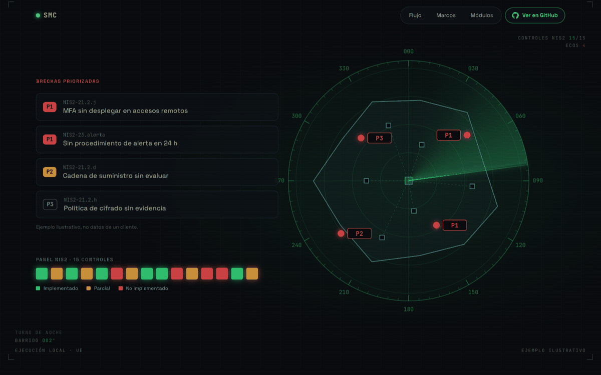
</p>

## Cómo funciona

```mermaid
flowchart LR
    A["🧭 Perfil del cliente<br/><sub>sector · tamaño · sector público · categoría ENS</sub>"] --> B["📚 Marcos aplicables<br/><sub>NIS2 siempre · ENS si aplica<br/>transversal · red</sub>"]
    B --> C["✅ Evaluación con evidencias<br/><sub>implementado · parcial<br/>no implementado · no aplica</sub>"]
    C --> D["🚨 Brechas priorizadas<br/><sub>P1 · P2 · P3</sub>"]
    D --> E["🗓️ Plan de acción<br/><sub>responsable · fecha · vencidas</sub>"]
    E --> F["📊 Informe HTML<br/>y dashboard multicliente"]
    F --> G["📈 Evolución y auditor<br/><sub>compare · soa · evidencias</sub>"]

    style A fill:#0d1117,stroke:#5ad1ff,color:#e6edf3
    style B fill:#0d1117,stroke:#5ad1ff,color:#e6edf3
    style C fill:#0d1117,stroke:#3cf58a,color:#e6edf3
    style D fill:#0d1117,stroke:#ff4d4d,color:#e6edf3
    style E fill:#0d1117,stroke:#ffb020,color:#e6edf3
    style F fill:#0d1117,stroke:#3cf58a,color:#e6edf3
    style G fill:#0d1117,stroke:#ffb020,color:#e6edf3
```

<p align="center">
  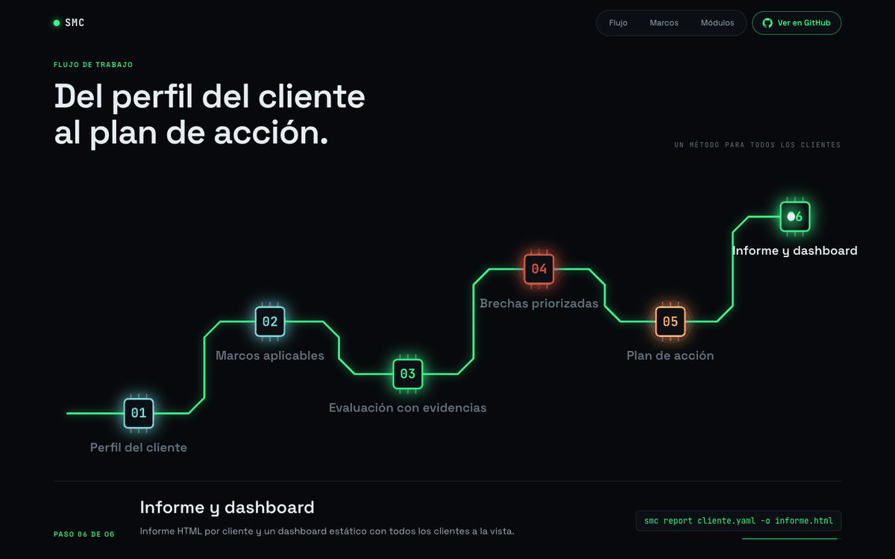
</p>

1. **Alcance.** Copia `assessments/assessment.template.yaml` y rellena el perfil del cliente.
2. **Marcos.** NIS2 siempre; ENS si `sector_publico` o `proveedor_sector_publico`, filtrado por su categoría (BÁSICA, MEDIA, ALTA); transversal y red siempre.
3. **Evaluación.** Estado de cada control y sus evidencias. Un control `implementado` sin evidencia sale como aviso: evidencia antes que checkbox.
4. **Brechas.** `smc gap` calcula el cumplimiento por marco y ordena lo que falta por prioridad.
5. **Plan.** `plan_accion:` en la evaluación y `smc plan` para ver acciones vencidas y brechas P1 sin acción.
6. **Entrega.** `smc report` para dirección (HTML imprimible a PDF) y `smc dashboard` para todos tus clientes.
7. **Seguimiento.** `smc compare` mide la evolución entre dos evaluaciones, `smc soa` entrega al auditor la declaración de aplicabilidad y `smc evidencias` vigila fechas, caducidades y huellas.

## Tres marcos, una sola rejilla

Evalúa una vez y reutiliza. El mapeo `mappings/nis2-ens-iso27001.csv` cruza cada control NIS2 con sus medidas ENS y los controles del Anexo A de ISO 27001:2022. Si un control no está evaluado pero su equivalente sí, el informe lo marca como **heredado** para que no se te escape.

<p align="center">
  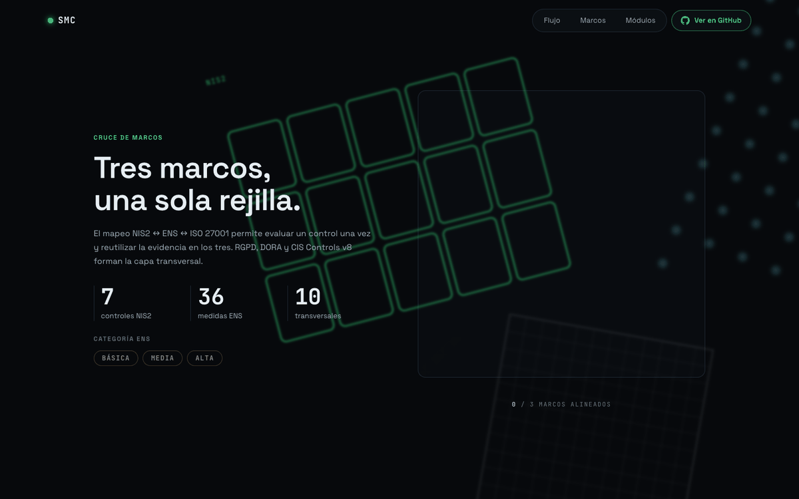
</p>

| Bloque | Base | Cuándo aplica |
|---|---|---|
| **NIS2** | Directiva (UE) 2022/2555, art. 20, 21 y 23 + Reglamento de Ejecución (UE) 2024/2690 | Línea base para **todos** los clientes (entidad esencial, importante o como referencia voluntaria) |
| **ENS** | Real Decreto 311/2022, Anexo II (73 medidas, 45 contrastadas con el BOE) con categoría mínima y refuerzos | Sector público y sus proveedores |
| **Transversal** | ISO/IEC 27001:2022, RGPD/LOPDGDD, DORA, CIS Controls v8 | Cualquier organización |
| **Red** | Módulo propio | Segmentación, perímetro, acceso remoto, DNS, Wi‑Fi, OT, monitorización |
| **Normativa** | NIS2 completa + CCN-CERT | Directiva, RE 2024/2690, guía de ENISA, anteproyecto español; guías CCN-STIC, BP e ITS enlazadas a controles (`smc refs`) |

### Priorización

```
prioridad = 50·estado + 30·criticidad + 10·entidad + 10·cobertura multinorma
P1 ≥ 75 · P2 ≥ 40 · P3 resto
```

Estado: no implementado 1, sin evaluar 0,75, parcial 0,5. Entidad: esencial 1, importante 0,5, otra 0. Un no implementado de criticidad alta en una entidad esencial es P1; uno de criticidad media en una entidad importante sin cobertura multinorma, P2.

## Toda la sala, no solo el cumplimiento

<p align="center">
  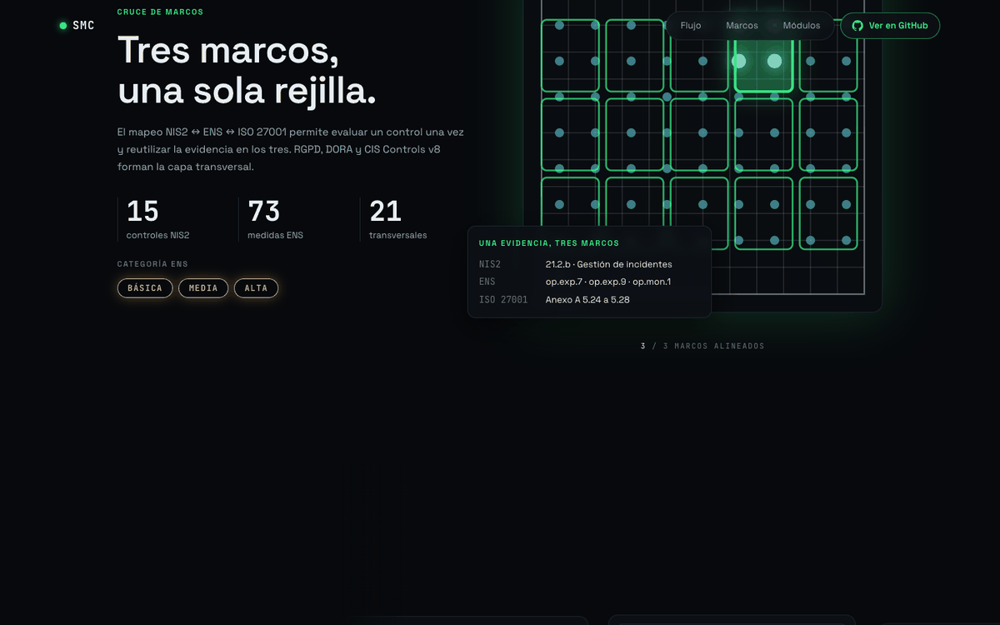
</p>

| Módulo | Qué mide | Dónde |
|---|---|---|
| 🛰️ **SOC** | SLA por severidad y tier, MTTD, MTTA, MTTC, MTTR | `smc soc` |
| 🎯 **MITRE ATT&CK** | Cobertura y madurez (niveles 1-5) de 8 casos de uso con playbook; capa para ATT&CK Navigator | `smc mitre`, `smc mitre --navigator` |
| 🧩 **Verticales** | 22 verticales (EDR/XDR, IAM, red, firewall, SASE, ZTNA, capas OSI, Threat Hunting, MDM, puesto de usuario, correo, cloud, datos, copias, OT, IA, seguridad ofensiva…) con madurez 0-5 o «no evaluable» con motivo, clasificadas por medida NIS2 21.2 | `smc verticals` |
| 🗡️ **Pentest y purple team** | Hallazgos con SLA y retest; ejercicios purple con cobertura por táctica | `smc pentest`, `smc purple` |
| 🤖 **IA** | 31 obligaciones del RIA con las fechas del Ómnibus Digital y seguridad de agentes (OWASP LLM 2025, MITRE ATLAS) | `smc ai` |
| 📅 **PMO** | Presupuesto, horas, valor ganado (EVM), riesgos y calendario `.ics` | `smc pmo` |
| 🔑 **Tecnologías** | Licencias, fin de soporte, certificados, sobredespliegue; evaluación de cada producto y estado de sus reglas (any-any, sin uso, revisión caducada) | `smc expiring`, `smc tech` |
| 💶 **Suscripciones** | Coste, renovaciones a 90 días y uso por debajo del 70 % de lo contratado | `smc subs` |
| 🩹 **Vulnerabilidades** | CVEs con SLA de remediación (KEV, EPSS, CVSS) y playbooks por tecnología y caso de uso | `smc vulns` |
| 🌐 **Protocolos** | 28 protocolos por capa OSI con sus debilidades típicas y 8 fuentes oficiales (NVD, ENISA, CISA KEV…) | `smc protocols` |
| 📰 **RSS** | 17 feeds de seguridad, 13 verificados, exportables a OPML | `smc rss` |
| 🗺️ **Mapa de red** | Dispositivos por zona y capa OSI con semáforo; JSON `smc-mapa/1` | `smc mapa` |
| 🧊 **Visor 3D** | El mapa como una sala de control en 3D: un solo HTML sin red, un botón por zona, tabla accesible | `smc visor` |
| ⚖️ **Normativa** | Base legal y guías CCN-CERT de cualquier control | `smc refs` |

## Lo que entregas

<table>
  <tr>
    <td width="50%">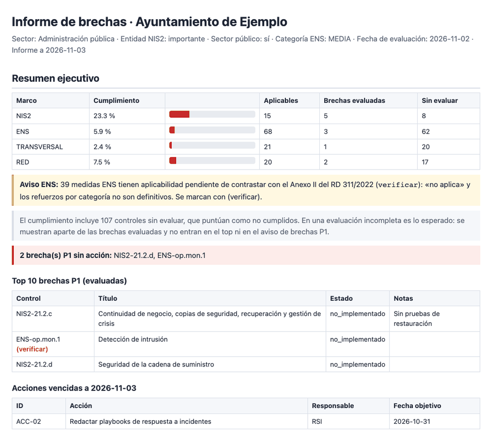</td>
    <td width="50%">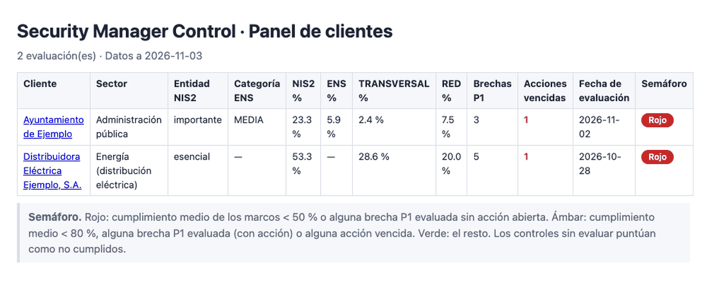</td>
  </tr>
  <tr>
    <td><b>Informe HTML</b> para dirección (responsabilidad NIS2 art. 20): resumen ejecutivo, brechas P1, plan de acción y avisos. Un solo fichero, imprimible a PDF.</td>
    <td><b>Dashboard multicliente</b>: cumplimiento por marco, brechas P1, acciones vencidas y semáforo por cliente. Estático, sin servidor.</td>
  </tr>
</table>

<sub>Capturas generadas con los dos ejemplos ficticios del repositorio. Salen en rojo porque la mayoría de sus controles están sin evaluar, que puntúan como no cumplidos.</sub>

## Empezar en 1 minuto

```bash
git clone https://github.com/pedri77/security-manager-control.git
cd security-manager-control
pip install -e .

smc validate                                                     # catálogos OK
smc gap assessments/examples/ejemplo-ayuntamiento.yaml           # brechas en Markdown
smc report assessments/examples/ejemplo-ayuntamiento.yaml -o /tmp/informe.html
smc dashboard assessments/examples -o /tmp/panel                 # abre /tmp/panel/index.html

smc compare assessments/examples/historico/ejemplo-energia-2026-q1.yaml assessments/examples/ejemplo-energia.yaml   # evolución entre evaluaciones
smc soa assessments/examples/ejemplo-energia.yaml --formato xlsx -o /tmp/aplicabilidad.xlsx   # salida para el auditor
smc evidencias assessments/examples/ejemplo-energia.yaml         # fechas, caducidades y huellas
smc report assessments/examples/ejemplo-energia.yaml -o /tmp/evolucion.html --anterior assessments/examples/historico/ejemplo-energia-2026-q1.yaml

smc mapa technologies/registry.template.yaml -o /tmp/mapa.json   # mapa de dispositivos
smc visor /tmp/mapa.json -o /tmp/visor.html                      # visor 3D, ábrelo en el navegador

smc pentest offensive/examples/ejemplo-pentest.yaml              # hallazgos, SLA y retest
smc purple offensive/examples/ejemplo-purple.yaml                # cobertura purple por táctica
smc mitre --purple offensive/examples/ejemplo-purple.yaml        # madurez ATT&CK con los ejercicios detectados
smc ai ai/inventario.template.yaml                               # RIA y seguridad de agentes
smc pmo pmo/examples/ejemplo-energia.yaml --ics /tmp/eventos.ics --assessment assessments/examples/ejemplo-energia.yaml
smc report assessments/examples/ejemplo-energia.yaml -o /tmp/completo.html --pentest offensive/examples/ejemplo-pentest.yaml --purple offensive/examples/ejemplo-purple.yaml --ai ai/inventario.template.yaml --pmo pmo/examples/ejemplo-energia.yaml
```

> [!TIP]
> **Vídeos de uso.** Ocho vídeos cortos (de 1:30 a 2:30) recorren todo esto con los ejemplos ficticios, con capítulos, comandos y transcripción: [`docs/videos/`](docs/videos/README.md).

## Comandos

```bash
smc validate                                              # valida catálogos
smc list                                                  # controles por marco
smc gap <evaluación.yaml> [-o informe.md] [--hoy AAAA-MM-DD]
smc plan <evaluación.yaml> [--hoy AAAA-MM-DD]             # vencidas y brechas sin acción
smc report <evaluación.yaml> -o informe.html [--registry registry.yaml] [--pentest p.yaml] [--purple p.yaml] \
        [--ai inventario.yaml] [--pmo proyecto.yaml] [--anterior evaluación-anterior.yaml] [--hoy AAAA-MM-DD]   # secciones opcionales
smc dashboard <dir_evaluaciones> -o <dir_salida> [--hoy AAAA-MM-DD]   # acompañantes <evaluación>.pentest|purple|ai|pmo.yaml
smc compare <anterior.yaml> <actual.yaml> [-o evolución.md] [--hoy AAAA-MM-DD]   # deltas por marco, controles, P1 y madurez
smc soa <evaluación.yaml> --formato csv|xlsx|html -o <fichero> [--hoy AAAA-MM-DD]   # declaración de aplicabilidad y evidencias
smc evidencias <evaluación.yaml> [--base <dir>] [--hoy AAAA-MM-DD]   # estado de cada evidencia; con --base, verifica sha256
smc soc soc/incidents.template.csv                        # MTTD/MTTA/MTTC/MTTR y % SLA
smc mitre [--navigator [-o capa.json]] [--purple p.yaml] [--hoy AAAA-MM-DD]   # cobertura y madurez ATT&CK; capa Navigator
smc pentest <pentest.yaml> [--hoy AAAA-MM-DD]             # hallazgos abiertos, fuera de SLA, retest pendiente
smc purple <purple.yaml> [--hoy AAAA-MM-DD]               # cobertura por táctica, no detectadas, mejoras
smc ai <inventario.yaml> [--hoy AAAA-MM-DD]               # obligaciones del RIA y seguridad de agentes
smc pmo <proyecto.yaml> [--ics eventos.ics] [--registry registry.yaml] [--assessment evaluación.yaml] [--hoy AAAA-MM-DD]
smc verticals <evaluación.yaml>                           # madurez por vertical y por medida NIS2
smc tech technologies/registry.template.yaml [--hoy AAAA-MM-DD] [--days 180]   # evaluación y estado de reglas
smc subs technologies/registry.template.yaml [--hoy AAAA-MM-DD] [--days 90]    # suscripciones y renovaciones
smc expiring technologies/registry.template.yaml --days 90
smc vulns vulnerabilities/tracker.template.csv            # CVEs abiertos y fuera de SLA
smc protocols [ID]                                        # protocolos por capa OSI y fuentes oficiales
smc rss [--opml [-o feeds.opml]]                          # listado de feeds y export OPML
smc mapa technologies/registry.template.yaml [--inventario resources/internal/inventory.template.yaml] \
        [--tracker <tracker.csv>] [--evaluacion <evaluación.yaml>] [--hoy AAAA-MM-DD] [-o mapa.json]
smc visor <mapa.json> -o visor.html                       # visor 3D offline del mapa
smc refs NIS2-21.2.b                                      # normativa y guías CCN-CERT
smc --version
```

Estados de control: `implementado` (1,0) · `parcial` (0,5) · `no_implementado` (0) · `no_aplica` (excluido) · sin evaluar (0, listado aparte; un estado no válido se trata igual, con aviso). Una acción `bloqueada` o `hecha` no cubre una brecha abierta.

## Pentest y purple team

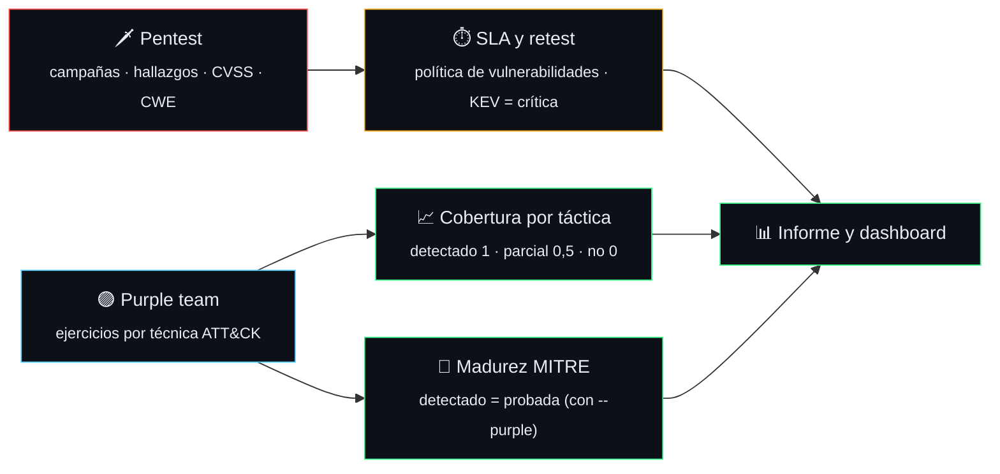

- `smc pentest <fichero>`: hallazgos abiertos, **fuera de SLA** (días desde la detección frente al plazo de [`vulnerabilities/policy.yaml`](vulnerabilities/policy.yaml)), **pendientes de retest** y aceptados sin fecha de revisión. Plantilla en [`offensive/pentest.template.yaml`](offensive/pentest.template.yaml).
- `smc purple <fichero>`: cobertura por táctica con el último ejercicio de cada técnica, técnicas no detectadas, mejoras abiertas y ejercicios de más de 12 meses. Plantilla en [`offensive/purple.template.yaml`](offensive/purple.template.yaml).
- **Purple y madurez MITRE.** Con `--purple` (en `smc mitre` y `smc report`), un ejercicio `detectado` y con fecha cuenta como prueba del caso de uso: nivel 4 («probada») y 5 si es de los últimos 90 días. Sin el fichero purple la madurez no cambia; `parcial` y `no_detectado` no suben nada.
- Los datos de un cliente (`offensive/*`) no se versionan: `.gitignore` solo deja plantillas y ejemplos ficticios.

## IA: RIA y agentes

`smc ai <inventario>` cruza el inventario de sistemas de IA de la organización (rol, nivel de riesgo, fecha de puesta en el mercado y evidencias) con las **31 obligaciones** del Reglamento (UE) 2024/1689 (RIA) y dice cuáles aplican, desde cuándo y cuáles faltan por evidencia.

| Obligación | Aplica desde |
|---|---|
| Prohibiciones y alfabetización (arts. 4 y 5) | 2025-02-02 |
| Transparencia, art. 50 (el marcado del art. 50.2 de sistemas ya en el mercado, hasta 2026-12-02) | 2026-08-02 |
| Alto riesgo del Anexo III (art. 6.2) | 2027-12-02 |
| Alto riesgo del Anexo I (art. 6.1) | 2028-08-02 |

Las fechas son las vigentes tras el **Ómnibus Digital sobre IA, Reglamento (UE) 2026/1744**. Cuatro obligaciones (evaluación de la conformidad, registro y vigilancia poscomercialización) llevan «verificar»: el texto no dice de forma expresa si siguen la fecha del nivel.

> [!IMPORTANT]
> **Esto no es asesoramiento jurídico.** SMC orienta; el texto que obliga es el publicado en el DOUE. El informe lo repite al principio.

Además, `smc ai` revisa cada agente con herramientas (seis comprobaciones AGT-01 a AGT-06: límite de llamadas, permisos, supervisión humana, registro, prompt injection y exfiltración) con su correspondencia en OWASP Top 10 for LLM Applications 2025 y MITRE ATLAS. Un dato ausente cuenta como «no consta», nunca como cumplido. Para un sistema de alto riesgo ya en el mercado antes de la fecha del capítulo III (art. 111.2), solo `cambios_significativos: false` declarado pasa sus obligaciones del capítulo III al régimen transitorio; si el campo falta, se emiten como pendientes con un aviso, y un valor que no sea `true` o `false` (también `autoridad_publica`) es un error de validación. El catálogo está en [`frameworks/ai-act/obligaciones.yaml`](frameworks/ai-act/obligaciones.yaml) y la plantilla en [`ai/inventario.template.yaml`](ai/inventario.template.yaml).

## Evolución, salida para auditor y evidencias

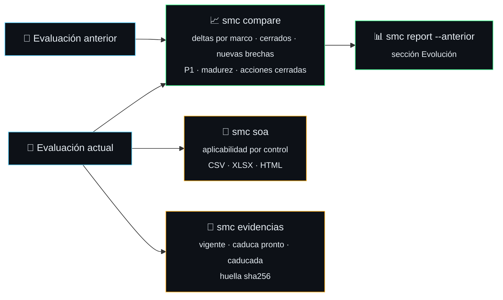

- **Comparación.** `smc compare <anterior> <actual>` reutiliza el análisis de brechas sobre las dos evaluaciones y da el cumplimiento por marco antes, después y delta; los controles cerrados, que mejoran, que empeoran, las nuevas brechas y los que dejan de evaluarse (evaluados antes, ausentes ahora; quitar una brecha del fichero no la cierra); las brechas P1 y la madurez de verticales en cada fecha; y las acciones del plan cerradas. Solo clasifica controles aplicables en las dos evaluaciones (un control ENS que deja de aplicar por la categoría no es una brecha nueva) y avisa de los IDs que no existen en el catálogo. Avisa si los clientes no coinciden, si la evaluación «actual» es anterior a la otra o si la categoría ENS cambia (el delta ENS no es comparable). Con el par ficticio del repositorio: NIS2 pasa de 50,0 % a 53,3 % y red de 15,0 % a 20,0 %. `smc report ... --anterior <evaluación>` añade al informe HTML la sección «Evolución».
- **Salida para el auditor.** `smc soa <evaluación> --formato csv|xlsx|html -o <fichero>` genera la declaración de aplicabilidad: una fila por control de cada marco con si aplica, la justificación si no aplica, estado, evidencias, prioridad, refuerzos ENS y mapeo a otros marcos. El CSV es UTF-8 con BOM (Excel) y solo lleva la aplicabilidad; el XLSX trae dos hojas, «Aplicabilidad» y «Evidencias»; el HTML se imprime a PDF desde el navegador. Las celdas cuyo primer carácter no blanco es `=`, `+`, `-` o `@` (o su variante de ancho completo), o que empiezan por tabulador, retorno o salto de línea, se prefijan con `'` para que Excel no las ejecute como fórmula; el XLSX descarta los caracteres que XML 1.0 no admite. Es un documento de trabajo: la declaración formal la firma el responsable de seguridad.
- **Evidencias con fecha y huella.** Una evidencia puede ser texto o `{ref, fecha, caduca | vigencia_dias, sha256}`. `smc evidencias` la clasifica en vigente, caduca pronto (30 días o menos), caducada o sin fecha; con `--base <directorio>` calcula el sha256 de los ficheros referenciados (solo rutas relativas dentro de la base, nunca `..`, rutas absolutas ni enlaces que salgan) y avisa si no coincide. Una evidencia caducada se avisa y se lista en el informe de brechas y en el dashboard, pero **no cambia la puntuación**. La caducidad sale en una sola lógica (`smc.evidencias`) en el informe de brechas, el HTML de cada marco, el dashboard y `smc soa`; las fechas deben ir como `AAAA-MM-DD` (una con hora se reduce a su día) y un valor no válido da un aviso, no un error.

Los ficheros de evidencia no se suben al repositorio: solo se referencian.

## PMO

`smc pmo <proyecto>` lleva el proyecto de remediación del cliente: presupuesto frente a coste real por partida (horas, licencias, servicios, formación), horas por rol y mes, **valor ganado** (PV, EV, AC, CPI, SPI), tareas retrasadas o sin control asociado, riesgos y próximos eventos a 30 días.

- `--ics eventos.ics` exporta el calendario (RFC 5545) para tu agenda.
- `--assessment` valida cada tarea contra el `plan_accion` de la evaluación y hereda sus controles; `--registry` suma las suscripciones del registro de tecnologías.
- Fórmulas y un caso calculado a mano en [`docs/pmo.md`](docs/pmo.md). Tarifas y presupuestos son datos de cliente: `pmo/*` está ignorado salvo plantilla y ejemplo ([ADR-005](docs/adr/ADR-005-pmo-datos-de-cliente.md)).

## Ecosistema

SMC enlaza con material público del mismo autor. Solo páginas públicas y repos públicos; la lista vive en [`resources/ecosistema.yaml`](resources/ecosistema.yaml) y `smc validate` la comprueba.

| Tema | Recurso |
|---|---|
| EDR/XDR | [EDR/XDR visual](https://pedri77.github.io/edr-visual-app/) |
| SASE | [SASE visual](https://pedri77.github.io/sase-visual-app/) |
| Firewalls | [Firewalls básicos](https://pedri77.github.io/Basic_Firewalls/) |
| Capas OSI | [Protección por capas OSI](https://pedri77.github.io/Basicos_Proteccion_Capas_OSI/) · [Modelo OSI](https://pedri77.github.io/modelo_OSI/) · [Vulnerabilidades por capa OSI](https://pedri77.github.io/vulnerabilidades-capas-osi/) |
| ICS/OT | [ICS/OT security studio](https://pedri77.github.io/ics-security-studio/) |
| WAF | [WAF forge](https://pedri77.github.io/wafforge/) |
| Correo | [Correo básico](https://pedri77.github.io/Basicos_email/) |
| Inteligencia de amenazas | [KEV dashboard](https://github.com/pedri77/kev_dash_project) (repo) · [Threat intelligence feeds](https://github.com/pedri77/threat-intelligence-feeds) (repo) |

Pack de evaluación ZTNA privado, disponible bajo petición. El visor 3D del mapa ya está en SMC (véase más abajo).

## Visor 3D del mapa de red

<p align="center">
  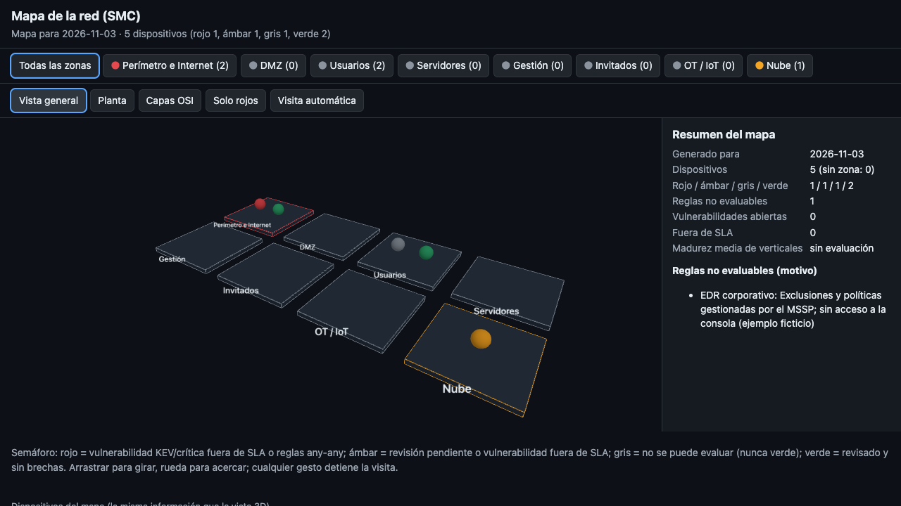
</p>

`smc visor` convierte el JSON `smc-mapa/1` en **una sola página HTML** que funciona sin red: sin CDN, sin `fetch`, con la política CSP `default-src 'none'`. Cada zona es una plataforma con un botón que la abre y enfoca la cámara; cada dispositivo es una pieza con su semáforo (rojo, ámbar, verde; **gris es «no evaluable» y nunca se pinta de verde**). El panel lateral lee los números del propio JSON (reglas no evaluables con su motivo, CVE fuera de SLA, KEV), hay vistas de planta, capas OSI y solo rojos, una visita automática que cede el control al primer gesto, respeto a `prefers-reduced-motion` y una tabla en texto con la misma información. Todo texto del JSON se inserta con `textContent`.

```bash
smc mapa technologies/registry.template.yaml -o mapa.json
smc visor mapa.json -o visor.html     # rc 2 con ERROR si el JSON no es un mapa smc-mapa/1
```

Decisiones: [ADR-003](docs/adr/ADR-003-mapa-3d-desde-teardown.md) y [ADR-004](docs/adr/ADR-004-three-js-vendorizado.md) (three.js vendorizado), más el contrato de datos en [`docs/mapa-3d.md`](docs/mapa-3d.md).

**Créditos.** El patrón (un modelo único, un botón por subsistema, panel de datos, visita guiada) viene de la skill [teardown](https://github.com/elvarofficial/teardown) de elvarofficial (MIT), que parte de [claude-motion](https://github.com/whaleyxbt/claude-motion) de whaleyxbt (MIT); el código del visor está escrito desde cero. El render usa [three.js](https://threejs.org/) 0.186.1 (MIT), incluido en `smc/assets/` con su licencia (`THREE-LICENSE`).

## Los datos del cliente no salen de tu equipo

<p align="center">
  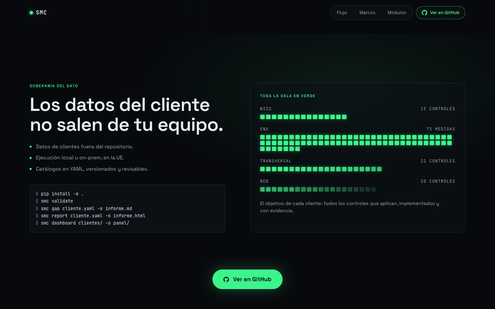
</p>

- **Datos de clientes fuera del repositorio** ([ADR-001](docs/adr/ADR-001-catalogos-como-datos-y-datos-de-cliente-fuera-del-repo.md)). `.gitignore` excluye evaluaciones reales, `*.html` y `dashboard/` como red de seguridad. Escribe las salidas fuera del repo.
- **Ejecución local u on-prem en la UE.** Sin llamadas de red, sin telemetría.
- **Informes autocontenidos** ([ADR-002](docs/adr/ADR-002-informes-html-y-dashboard-estatico.md)): CSS en línea, sin JavaScript, fuentes ni recursos externos. Todo texto de la evaluación se escapa.
- **Catálogos como datos.** Actualizar un marco es un PR sobre YAML, revisable sin tocar código. Los IDs (`NIS2-21.2.a`, `ENS-op.acc.6`, `TRV-RGPD-01`, `NET-SEG-01`) son contrato: no se renombran, se deprecan.

## Estructura

```
security-manager-control/
├── frameworks/          nis2 · ens · transversal (controls.yaml) · ai-act (obligaciones RIA)
├── mappings/            nis2-ens-iso27001.csv
├── network/             módulo de red
├── normativa/           NIS2 completa · guías CCN-CERT
├── soc/                 SLA · métricas · 22 verticales · casos de uso MITRE
├── technologies/        registro de tecnologías
├── vulnerabilities/     política · tracker · 28 protocolos · playbooks
├── resources/           inventario interno y de terceros · RSS · ecosistema
├── assessments/         plantilla + ejemplos ficticios
├── offensive/           plantillas de pentest y purple team + ejemplos
├── ai/                  plantilla de inventario de IA
├── pmo/                 plantilla de proyecto + ejemplo
├── smc/                 CLI (gap, plan, report, dashboard, compare, soa, evidencias, soc, mitre, pentest, purple, ai, pmo, mapa, visor…) · assets/ three.js vendorizado
├── tests/               635 tests
└── docs/                PRD · ADR · plan del enjambre · imágenes
```

## Hoja de ruta

| Versión | Entregable | Estado |
|---|---|---|
| v0.1 | Catálogos YAML, plantillas, `smc gap` | ✅ |
| v0.2 | Aplicabilidad ENS por categoría, priorización por riesgo, mapeos completos | ✅ |
| v0.3 | Informe HTML/PDF y plan de acción | ✅ |
| v0.4 | Dashboard multicliente (estático, local) | ✅ |
| v0.5 | 20 verticales (Threat Hunting, MDM, puesto, firewall, SASE, ZTNA, capas OSI), evaluación de tecnologías, reglas y suscripciones, 28 protocolos con fuentes oficiales, madurez MITRE con 8 playbooks y capa Navigator, 17 feeds RSS, ecosistema y mapa de red (`smc mapa`) | ✅ |
| v0.6 | Visor 3D offline del mapa (`smc visor`), informe y dashboard con tecnologías, reglas, suscripciones y madurez MITRE (`--registry`), Anexo II del ENS contrastado con el BOE (45 de 73 medidas) | ✅ |
| v0.7 | Pentesting y purple team (`smc pentest`, `smc purple`, madurez MITRE con `--purple`), RIA con las fechas del Ómnibus Digital y seguridad de agentes (`smc ai`), PMO con valor ganado y calendario (`smc pmo`), 22 verticales, informe y dashboard con las secciones nuevas | ✅ |
| v0.8 | Comparación entre evaluaciones (`smc compare`, sección «Evolución» con `--anterior`), salida para auditor (`smc soa` en CSV, XLSX y HTML), evidencias con fecha, caducidad y huella (`smc evidencias`), evidencia caducada en el dashboard, CI en GitHub Actions y régimen transitorio del art. 111.2 del RIA | ✅ |
| v0.8.1 | Endurecimiento de v0.8: art. 111.2 solo con `cambios_significativos: false` declarado (dato ausente no recorta), una sola lógica de caducidad, XLSX válido, comparación solo de controles aplicables, CSV más estricto, caducidad en el informe HTML y CI con los comandos nuevos y Python 3.10 | ✅ |
| v0.9 | Contrastar las 28 medidas ENS que dependen de las dimensiones C/I/T/A/D con las guías CCN-STIC; probar el visor en GPU integrada y móvil; conectores de evidencias, ingesta NVD/KEV/EPSS, cumplimiento por dominio | 📋 |

## Limitaciones conocidas

> [!WARNING]
> **ENS contrastado en parte.** Las 73 medidas se han contrastado con el Anexo II del RD 311/2022 (BOE-A-2022-7191): 45 están confirmadas y 28 de las 73 siguen con `verificar: true` porque su aplicabilidad depende de las dimensiones de seguridad (C/I/T/A/D) y no se han cruzado con las guías CCN-STIC. Los informes las marcan con «(verificar)» y avisan en el resumen.

- Las verticales nuevas (mapeo NIS2, controles), la madurez de los casos de uso y los protocolos son juicio inicial sobre datos de muestra, sin fuente normativa ni SOC real. La capa OSI de TLS y BGP es una convención discutible.
- El visor 3D está probado en Chrome con render por software; falta probarlo en GPU integrada y en móvil en vertical.
- Los descriptores de nivel de las verticales de IA y seguridad ofensiva están pendientes de validar por el Security Manager. El catálogo RIA no sustituye al texto del DOUE: las obligaciones marcadas «verificar» necesitan revisión humana.
- Las criticidades NIS2 son un juicio inicial sin fuente normativa: afectan al orden de prioridad, no al cumplimiento.
- «Sin evaluar» puntúa como no cumplido: una evaluación incompleta sale en rojo. Es lo esperado; el informe separa las brechas evaluadas de las pendientes.
- La ley española de transposición de NIS2 (*Anteproyecto de Ley de Coordinación y Gobernanza de la Ciberseguridad*) sigue en tramitación: revisar el catálogo cuando se publique en el BOE.

## Licencia

[Apache-2.0](LICENSE). Copyright 2026 David Moya García. Incluye three.js (MIT); ver [NOTICE](NOTICE).

---

<div align="center">

<a href="https://pedri77.github.io/smc-cinematica/"></a>

<sub>Hecho por <a href="https://github.com/pedri77">pedri77</a>. Construido con un enjambre de agentes: el plan y los informes de cada tarea están en <a href="docs/plan/">docs/plan</a>.</sub>

</div>
