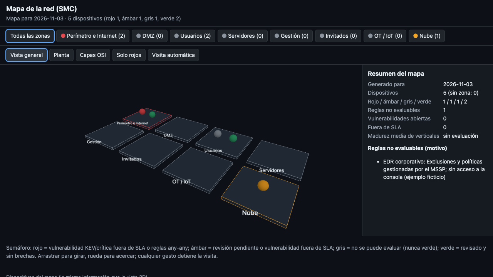

# Mapa 3D de dispositivos (diseño y contrato de datos)

Estado: contrato implementado (`smc mapa`, T15) y visor 3D offline implementado (`python -m smc.visor`, T20; el subcomando `smc visor` llega con T22). Decisión: [ADR-003](adr/ADR-003-mapa-3d-desde-teardown.md).

## Idea

La skill `teardown` (elvarofficial/teardown, MIT, sobre whaleyxbt/claude-motion, MIT) convierte una máquina en una página HTML offline que se puede desmontar. Aquí la «máquina» es la **red del cliente**: cada zona es un subsistema que se abre, cada dispositivo una pieza, y los paneles leen los números reales del JSON que genera SMC.

## Comando

```
smc mapa technologies/registry.yaml [--inventario internal.yaml] [--tracker tracker.csv] \
         [--evaluacion assessment.yaml] [--hoy AAAA-MM-DD] [--days 180] -o mapa.json
```

Sin `-o` escribe en stdout. rc=2 si falta un fichero o el YAML/CSV está roto. Determinista para una misma `--hoy`.

## Qué se reutiliza de teardown y qué se cambia

| Pieza de teardown | En el mapa de red |
|---|---|
| Un modelo único mueve piezas y paneles («números reales, una sola fuente») | El JSON `smc-mapa/1` es la única fuente: ni el visor ni los paneles calculan nada |
| Un botón por subsistema que abre la pieza que trabaja | Un botón por zona (Perímetro, DMZ, Usuarios, Servidores, Gestión, Invitados, OT/IoT, Nube) que aísla la zona y la acerca |
| Cortes y rayos X | Corte por zona; vista «solo rojos»; vista por capa OSI (se separan las capas en altura) |
| Vistas de cámara | General 3/4, planta (zonas), por capas OSI, por vertical |
| Visita automática que cede el control al primer gesto y lo devuelve tras un rato de calma | Igual: recorre primero las zonas en rojo y luego las demás; cualquier clic, arrastre, rueda o tecla cede el control |
| HTML offline de una sola página | Igual: un fichero, sin CDN ni red; la librería 3D va incluida; texto en castellano |
| Grabación a vídeo fotograma a fotograma | Opcional y posterior: útil para el comité, no para el análisis |
| Piezas torneadas, cinemática, motores, sonido de máquina | Se cambian por: dispositivos como figuras por tipo, colores por estado, sin física ni sonido |
| Dimensiones reales de la máquina | Cifras reales del JSON (reglas, any-any, vulnerabilidades fuera de SLA, madurez) |

No se copia código de teardown al repositorio. El visor se escribirá aparte y, si reutiliza fragmentos del kit, conservará el aviso MIT de teardown y de claude-motion.

## Esquema `smc-mapa/1`

```
{
  "schema": "smc-mapa/1",
  "generado_para": "2026-11-03",            // --hoy; no es la hora de ejecución
  "umbral_revision_reglas_dias": 180,
  "zonas": [                                // siempre las 8, en este orden
    {"id": "perimetro", "nombre": "Perímetro e Internet", "semaforo": "rojo",
     "n_dispositivos": 2, "dispositivos": [ <dispositivo>, ... ]},
    ... dmz, usuarios, servidores, gestion, invitados, ot_iot, nube
  ],
  "sin_zona": [ <dispositivo con "zona": null y "motivo_sin_zona"> ],
  "resumen": {
    "dispositivos": 6, "sin_zona": 1,
    "por_semaforo": {"rojo": 1, "ambar": 2, "gris": 1, "verde": 2},
    "reglas_no_evaluables": 1,
    "vulnerabilidades_abiertas": 2, "vulnerabilidades_fuera_sla": 2,
    "madurez_verticales_media": 2.75        // null sin --evaluacion
  },
  "avisos": [ "texto", ... ]                // ids duplicados, tracker huérfano, avisos de la evaluación
}
```

Dispositivo (de `technologies/registry` y de `activos` del inventario; mismo formato):

```
{
  "id": "TEC-0002", "nombre": "Firewall perimetral",
  "tipo": "tecnologia" | <tipo del activo: servidor, puesto, red, ot...>,
  "origen": "registro" | "inventario",
  "zona": "perimetro" | null,
  "capa_osi": 3 | null, "capa_osi_origen": "declarada" | "vertical" | "desconocida",
  "vertical": "VRT-FW" | null,
  "reglas": {
    "estado": "revisadas" | "sin_revisar" | "no_evaluable" | "sin_datos",
    "n_reglas": 240, "reglas_any_any": 6, "reglas_sin_uso": 58,
    "dias_sin_revisar": 342,                // null si no_evaluable o sin_datos
    "caducada": true,                       // solo sin_revisar
    "motivo": "…"                           // OBLIGATORIO y solo si no_evaluable
  },
  "vulnerabilidades": {                     // solo las no remediadas del tracker
    "abiertas": 1, "fuera_sla": 1, "kev_fuera_sla": 1,
    "kev_o_criticas_abiertas": 1,           // KEV o crítica efectiva, dentro o fuera de SLA
    "peor_severidad": "critica" | "alta" | "media" | "baja" | null,
    "cves_fuera_sla": ["CVE-0000-0001"]
  },
  "semaforo": "rojo" | "ambar" | "gris" | "verde",
  "semaforo_motivos": ["…"],
  "evaluacion": {"cobertura_pct": 100, "configuracion": "por_defecto", "madurez": 2} | null,
  "madurez_vertical": 4 | null              // de --evaluacion; null si no hay dato
}
```

### Entradas nuevas en los registros (opcionales)

| Campo | Dónde | Valores |
|---|---|---|
| `zona` | tecnología del registro o activo del inventario | `perimetro, dmz, usuarios, servidores, gestion, invitados, ot_iot, nube` (alineadas con NET-SEG-01) |
| `capa_osi` | ídem | entero 1-7; si falta o es inválido se usa la capa por defecto de la vertical (`capa_osi_origen: vertical`); sin vertical conocida queda `null` |

Un dispositivo sin `zona` o con una zona fuera del catálogo va a `sin_zona` con su `motivo_sin_zona`; no rompe nada y el visor lo dibuja en un área aparte. Solo se exportan los campos del esquema: no salen propietarios, costes, CPE, rutas ni notas.

### Reglas del semáforo

Se evalúan en este orden y gana la primera que se cumple:

1. **Rojo**: alguna vulnerabilidad abierta fuera de SLA está en KEV o es crítica, o hay reglas any-any (> 0).
2. **Ámbar**: hay otras vulnerabilidades fuera de SLA, hay una KEV o crítica abierta aunque esté dentro de SLA, o las reglas están sin revisar o con la revisión caducada (más de `umbral_revision_reglas_dias`).
3. **Gris**: las reglas son `no_evaluable` (con motivo) o `sin_datos`. No se sabe: nunca verde.
4. **Verde**: reglas revisadas, sin any-any y sin vulnerabilidades fuera de SLA.

Severidad efectiva (`policy.yaml`): se normaliza (minúsculas, sin tildes); una KEV cuenta como crítica (SLA de 7 días) y una severidad fuera de la política también, con un aviso en `avisos`.

Fuera de SLA = días desde `detectado` estrictamente mayores que el SLA de la severidad en `vulnerabilities/policy.yaml`. El semáforo de una zona es el peor de sus dispositivos (rojo > ámbar > gris > verde); una zona vacía es gris.

## Boceto de las vistas

Vista general (3/4): la red como una maqueta de losas apiladas.

```
            Internet
               |
        +------v------+            [Zonas]  (un botón cada una)
        |  PERÍMETRO  |  ● ● ○     Perímetro  Usuarios  Servidores
        +------+------+            DMZ        Gestión   Invitados
   +-----------+-----------+       OT/IoT     Nube      Sin zona
   |           |           |
 +-v--+     +--v---+    +--v------+     Panel (lee el JSON)
 |DMZ |     |USUAR.|    |SERVIDOR.|     Zona: Perímetro   Semáforo: ROJO
 +----+     +------+    +---------+     Firewall perimetral  capa 3
   ● rojo  ● ámbar  ○ gris  ◌ verde      reglas: 240 · any-any: 6
                                         KEV fuera de SLA: 1 (CVE-0000-0001)
```

Vista por capas OSI (cada dispositivo sube o baja según `capa_osi`; los de capa desconocida, en una franja aparte):

```
 L7 Aplicación  |  EDR   MDM   SASE   ZTNA
 L4 Transporte  |  Firewall
 L3 Red         |  Firewall sede   Router
 L2 Enlace      |  Switch OT
```

Visita automática: orden por semáforo (rojo primero), 6 s por zona, panel con las cifras; el primer gesto cede el control y 25 s de calma lo devuelven. Los `no_evaluable` se muestran con un candado y su `motivo` en el panel. Cada elemento visual tiene su equivalente en texto (tabla) para accesibilidad e impresión.

## Visor (T20)

```
python -m smc.visor mapa.json -o visor.html     # sin -o escribe en stdout; rc=2 si el JSON no es un smc-mapa/1 válido
```

En código: `from smc.visor import generar_visor; html = generar_visor(mapa_dict)` (lanza `ValueError` si el mapa no cumple el esquema).



- Una sola página (~565 KiB) con three.js y el JSON incrustados: sin red, sin CDN, sin `fetch`; lleva una CSP `default-src 'none'`.
- Una zona = una plataforma con un botón que la abre y acerca la cámara; los dispositivos son piezas coloreadas por semáforo (gris nunca se pinta verde; un valor desconocido cae en gris). `sin_zona` se dibuja en una plataforma aparte.
- Vistas: general, planta, capas OSI (las piezas suben según `capa_osi`; capa desconocida, franja inferior) y «solo rojos». Clic en una pieza muestra su detalle.
- Visita automática: zonas en rojo primero, 6 s por zona; cualquier clic, rueda o tecla cede el control y 25 s de calma la devuelven. Con `prefers-reduced-motion` no hay visita automática ni transiciones.
- Panel: lee los números del JSON (resumen, reglas no evaluables con su motivo, KEV fuera de SLA). Todo texto del JSON entra al DOM con `textContent`; el JSON va en `<script type="application/json">` con `<` escapado como `\u003c`.
- Alternativa en texto: tabla con la misma información (se genera en el servidor con `html.escape`, funciona sin JavaScript ni WebGL).
- three.js está vendorizado en `smc/assets/` (ADR-004).

## Siguiente paso

Cablear `smc visor` en el CLI (T22) y probar el visor en una GPU integrada y en móvil vertical.
