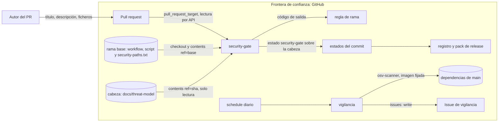

# Threat model — SMC-009 · Puerta de seguridad en PR y vigilancia diaria de dependencias

**Versión:** v2 · **Fecha:** 2026-11-07 · **Autor:** engineering (dev-proyecto, T51 y T53) · **Revisor:** independent-reviewer
**Issue:** #28 · **ADR relacionado:** n/a

Alcance: dos piezas. (A) `security-gate`: workflow `.github/workflows/security-gate.yml` (evento `pull_request_target`, checkout de la
rama base, sin ejecutar nada del PR) que ejecuta `scripts/change_evidence.py security --pr N`, con la lista `.github/security-paths.txt`,
el estado de commit `security-gate`, el campo `security` del registro y el hueco del pack. (B) `vigilancia.yml` diario con
`scripts/vigilancia.py` y `issues: write` (tarea T52, con sus tests en `tests/test_vigilancia.py`).

## 1. Alcance y activos
| Activo | Clasificación (ENS: básica/media/alta) | Datos personales | Propietario |
|---|---|---|---|
| Integridad de la rama principal (qué código se fusiona) | media | no | David Moya |
| Lista `.github/security-paths.txt` y plantilla de threat model | media | no | David Moya |
| Registro de cambio y evidence pack (trazabilidad ante auditoría) | media | no | David Moya |
| Token `GITHUB_TOKEN` del job (lectura; en la puerta, `statuses: write`; en vigilancia, `issues: write`) | media | no | David Moya |
| Issue `[vigilancia] vulnerabilidades en dependencias` | básica | no | David Moya |

## 2. Diagrama de flujo de datos

## 3. Amenazas (STRIDE)
| ID | Categoría | Amenaza | Componente | Prob. (1-3) | Impacto (1-3) | Riesgo | Mitigación | Test que la verifica | Estado |
|---|---|---|---|---|---|---|---|---|---|
| T1 | Tampering | El PR edita `security-paths.txt` (vaciándola o quitando su ruta) para librarse de la puerta | lectura de la lista | 2 | 3 | 6 | La lista se lee de la rama base, nunca de la cabeza; tocar la lista activa la puerta, también borrándola, y «no aplica» no vale en ese caso | `tests/test_change_evidence.py::test_puerta_decide_si_aplica[lista_de_la_cabeza_vaciada_no_libra]`, `tests/test_change_evidence.py::test_puerta_decide_si_aplica[lista_ampliada_en_la_cabeza_no_cuenta]`, `tests/test_change_evidence.py::test_puerta_decide_si_aplica[tocar_la_lista_activa_la_puerta]`, `tests/test_change_evidence.py::test_puerta_decide_si_aplica[borrar_la_lista_activa_la_puerta]`, `tests/test_change_evidence.py::test_exige_threat_model_o_linea_no_aplica_con_motivo` | mitigada |
| T2 | Tampering | El PR mueve un fichero sensible fuera de su ruta (renombrado) para no casar con la lista | filtro de rutas | 2 | 3 | 6 | Se comprueban `filename` y `previous_filename` de `pulls/N/files`; la lista de ficheros se lee entera y 3000 ficheros (tope de la API) es error; la exención de release mira también el origen de cada renombrado (T18) | `tests/test_change_evidence.py::test_puerta_decide_si_aplica[renombrado_desde_ruta_sensible_aplica]`, `tests/test_change_evidence.py::test_modo_security[3000_ficheros_es_lectura_incompleta]`, `tests/test_change_evidence.py::test_puerta_decide_si_aplica[release_renombrado_desde_ruta_sensible_aplica]` | mitigada |
| T3 | Spoofing | Una rama llamada `release-please--branches--*` (o un fork) para que el PR se tome por PR de release y se exima | exención de release | 2 | 3 | 6 | La exención exige mismo repositorio, que todos los ficheros sean de versión y que el origen de cada renombrado o copia también lo sea (`is_release_pr`); los ficheros extra salen de `release-please-config.json` de la rama base, leído con `ref` escapado | `tests/test_change_evidence.py::test_puerta_decide_si_aplica[rama_de_release_con_otro_fichero_aplica]`, `tests/test_change_evidence.py::test_puerta_decide_si_aplica[rama_de_release_desde_un_fork_aplica]`, `tests/test_change_evidence.py::test_puerta_decide_si_aplica[release_renombrado_desde_ruta_sensible_aplica]`, `tests/test_change_evidence.py::test_puerta_decide_si_aplica[release_copiado_desde_ruta_sensible_aplica]`, `tests/test_change_evidence.py::test_allowed_release_files_escapa_ref` | mitigada |
| T4 | Tampering | Línea `Threat model: no aplica:` escondida en un comentario HTML, con motivo vacío o de relleno (`<motivo>`, `.`), o la plantilla del PR sin rellenar | descripción del PR | 3 | 2 | 6 | Se ignoran los comentarios HTML (también sin cerrar); la línea debe empezar la línea; el motivo tiene al menos 15 caracteres sin contar placeholders `<...>` y 8 letras o cifras | `tests/test_change_evidence.py::test_exige_threat_model_o_linea_no_aplica_con_motivo[plantilla_del_pr_sin_rellenar_no_pasa]`, `tests/test_change_evidence.py::test_exige_threat_model_o_linea_no_aplica_con_motivo[linea_sin_motivo_0]`, `tests/test_change_evidence.py::test_exige_threat_model_o_linea_no_aplica_con_motivo[linea_en_comentario_html_0]`, `tests/test_change_evidence.py::test_exige_threat_model_o_linea_no_aplica_con_motivo[motivo_no_valido_0]`, `tests/test_change_evidence.py::test_funciones_puras_de_la_puerta[no_aplica_invalid_rechaza_1]` | mitigada |
| T5 | Tampering | Threat model entregado sin hacer: plantilla intacta, vacío, sin filas de amenaza, estados fuera del vocabulario, `abierta` escondida (sin `\|` inicial, en otra tabla o en una segunda columna «Estado»), `mitigada` sin mitigación ni test, o aceptaciones sin fecha | contenido del threat model | 3 | 2 | 6 | Se exige al menos una fila de amenaza en una tabla con una sola columna «Estado»; estado exactamente `mitigada` o `aceptada`; `mitigada` con celdas de mitigación y de test no vacías; `abierta` en cualquier celda de cualquier línea de tabla no pasa; sin placeholders; por cada `aceptada`, su fila en la sección 5 con «Fecha» con formato de fecha; si el fichero existe se juzga aunque haya línea de no aplicación | `tests/test_change_evidence.py::test_contenido_del_threat_model[la_plantilla_sin_rellenar_no_pasa]`, `tests/test_change_evidence.py::test_contenido_del_threat_model[sin_filas_de_amenaza_1]`, `tests/test_change_evidence.py::test_contenido_del_threat_model[estado_fuera_del_vocabulario_0]`, `tests/test_change_evidence.py::test_contenido_del_threat_model[aceptada_con_fecha_vacia_no_pasa]`, `tests/test_change_evidence.py::test_contenido_del_threat_model[una_fila_abierta_entre_cerradas]`, `tests/test_change_evidence.py::test_contenido_del_threat_model[abierta_sin_pipe_inicial_no_pasa]`, `tests/test_change_evidence.py::test_contenido_del_threat_model[abierta_en_tabla_sin_columna_estado_no_pasa]`, `tests/test_change_evidence.py::test_contenido_del_threat_model[dos_columnas_estado_no_pasan]`, `tests/test_change_evidence.py::test_contenido_del_threat_model[mitigada_sin_mitigacion_no_pasa]`, `tests/test_change_evidence.py::test_contenido_del_threat_model[mitigada_sin_test_no_pasa]`, `tests/test_change_evidence.py::test_exige_threat_model_o_linea_no_aplica_con_motivo[si_existe_el_threat_model_se_juzga_aunque_haya_linea]` | mitigada |
| T6 | Tampering | Threat model de la rama base, de otra tarea, de otra issue o ya existente sin tocar presentado como el del cambio | lectura del threat model | 2 | 2 | 4 | Se lee de la cabeza del PR por SHA, debe estar añadido o modificado en `pulls/N/files` (un renombrado cuenta como tocado), hace falta uno por cada TASK_ID y declara `**Issue:** #N` con N entre las issues que cierra el PR | `tests/test_change_evidence.py::test_exige_threat_model_o_linea_no_aplica_con_motivo[threat_model_solo_en_la_base_no_vale]`, `tests/test_change_evidence.py::test_exige_threat_model_o_linea_no_aplica_con_motivo[modelo_existente_en_la_cabeza_sin_tocar_no_vale]`, `tests/test_change_evidence.py::test_exige_threat_model_o_linea_no_aplica_con_motivo[task_de_otra_tarea_con_modelo_existente_no_vale]`, `tests/test_change_evidence.py::test_exige_threat_model_o_linea_no_aplica_con_motivo[modelo_renombrado_cuenta_como_tocado]`, `tests/test_change_evidence.py::test_exige_threat_model_o_linea_no_aplica_con_motivo[varias_tareas_cada_una_necesita_el_suyo]`, `tests/test_change_evidence.py::test_exige_threat_model_o_linea_no_aplica_con_motivo[modelo_de_otra_issue_no_vale]`, `tests/test_change_evidence.py::test_exige_threat_model_o_linea_no_aplica_con_motivo[modelo_sin_issue_declarada_no_vale]` | mitigada |
| T7 | Denial of service | La API de GitHub falla o devuelve un 403 y la puerta pasa en abierto | lectura de la API | 2 | 3 | 6 | Cualquier fallo de lectura sale con 1; solo un 404 del fichero es ausencia; una lista ausente en la base aplica la puerta y falla en cerrado (T19); carpetas, enlaces y ficheros grandes son error | `tests/test_change_evidence.py::test_modo_security`, `tests/test_change_evidence.py::test_modo_security[403_en_la_lista_no_es_lista_ausente]`, `tests/test_change_evidence.py::test_leer_fichero_distingue_ausencia_de_error`, `tests/test_change_evidence.py::test_modo_security[sin_lista_en_la_base_falla_en_cerrado]` | mitigada |
| T8 | Elevation of privilege | `pull_request_target` ejecuta código del PR con un token con permisos o datos del PR interpolados en el shell (inyección por título) | `security-gate.yml` | 2 | 3 | 6 | El checkout es el de la rama base, sin `ref` ni `repository`; ningún paso ejecuta ni lee del disco nada de la cabeza (el script solo lee el PR por la API); permisos de lectura y solo `statuses: write` en el job; acciones fijadas por SHA, sin credenciales persistidas y datos del PR por variable de entorno | `tests/test_change_evidence.py::test_workflow_security_gate_y_lista_de_rutas[usa_pull_request_target_con_los_tipos_de_edicion]`, `tests/test_change_evidence.py::test_workflow_security_gate_y_lista_de_rutas[un_solo_checkout_el_de_la_base_sin_ref_ni_repositorio]`, `tests/test_change_evidence.py::test_workflow_security_gate_y_lista_de_rutas[ningun_with_ni_ref_apunta_a_la_cabeza]`, `tests/test_change_evidence.py::test_workflow_security_gate_y_lista_de_rutas[no_interpola_datos_del_pr_en_el_shell]`, `tests/test_change_evidence.py::test_workflow_security_gate_y_lista_de_rutas[actions_fijadas_por_sha_y_sin_credenciales_persistidas]`, `tests/test_change_evidence.py::test_workflow_security_gate_y_lista_de_rutas[solo_escribe_statuses_y_solo_en_el_job]` | mitigada |
| T9 | Repudiation | Un `security-review` publicado después del merge se cuenta como revisión previa; o un PR que activa la puerta se fusiona sin él | registro y pack | 2 | 2 | 4 | El estado se corta en `merged_at` como `blind-review`; el pack anota hueco si la puerta aplica y el estado no es `success` | `tests/test_change_evidence.py::test_registro_con_campo_security[security_review_posterior_al_merge_no_cuenta]`, `tests/test_change_evidence.py::test_pack_de_release_anota_el_hueco_de_security_review[aplica_sin_security_review_deja_hueco]`, `tests/test_change_evidence.py::test_pack_de_release_anota_el_hueco_de_security_review[security_review_solo_posterior_al_merge_deja_hueco]` | mitigada |
| T10 | Information disclosure | El token del job se filtra por el registro o por el log | `GITHUB_TOKEN` | 1 | 2 | 2 | El script no imprime el entorno ni el token; el token es de lectura salvo `statuses: write` en el job de la puerta y no se persiste en `.git` | `tests/test_change_evidence.py::test_workflow_security_gate_y_lista_de_rutas[solo_escribe_statuses_y_solo_en_el_job]`, `tests/test_change_evidence.py::test_workflow_security_gate_y_lista_de_rutas[actions_fijadas_por_sha_y_sin_credenciales_persistidas]` | mitigada |
| T11 | Tampering | Un PR modifica `change_evidence.py` o el workflow de la puerta para que pase: con `pull_request` el job ejecutaría la versión del propio PR | job `security-gate` | 2 | 3 | 6 | La puerta corre con `pull_request_target`: workflow y script salen de la rama base, así que lo que cambie el PR no se ejecuta hasta fusionarlo; además ambos están en la lista, exigen threat model y «no aplica» no vale para ellos. El job entra en la regla de rama cuando David lo decida (T23) | `tests/test_change_evidence.py::test_workflow_security_gate_y_lista_de_rutas[usa_pull_request_target_con_los_tipos_de_edicion]`, `tests/test_change_evidence.py::test_workflow_security_gate_y_lista_de_rutas[pr_meta_ya_no_tiene_la_puerta]`, `tests/test_change_evidence.py::test_workflow_security_gate_y_lista_de_rutas[un_solo_checkout_el_de_la_base_sin_ref_ni_repositorio]`, `tests/test_change_evidence.py::test_workflow_security_gate_y_lista_de_rutas[la_lista_de_rutas_sensibles_del_repositorio]`, `tests/test_change_evidence.py::test_exige_threat_model_o_linea_no_aplica_con_motivo` | mitigada |
| T13 | Spoofing | Un motivo libre de `no aplica` que no es cierto en un PR sensible de otro tipo (`scripts/*`, `smc/*`) | descripción del PR | 3 | 2 | 6 | No vale en PR de tipo `sec` ni si toca la lista, `change_evidence.py` o un workflow; el motivo exige 15 caracteres reales; queda en el registro (`threat_model`: `no aplica: motivo`) y lo ve la revisión ciega | `tests/test_change_evidence.py::test_exige_threat_model_o_linea_no_aplica_con_motivo`, `tests/test_change_evidence.py::test_registro_con_campo_security[recoge_la_linea_no_aplica]` | aceptada |
| T14 | Elevation of privilege | `vigilancia.yml` con `issues: write` procesa la salida de `osv-scanner` | job de vigilancia | 2 | 2 | 4 | Permisos mínimos (`contents: read`, `issues: write`); el cuerpo de la issue va por stdin y nunca por argumento; el token entra por variable de entorno y no se interpola nada en el shell. El contenido de terceros de la issue no entra en esta fila | `tests/test_vigilancia.py::test_permisos_minimos`, `tests/test_vigilancia.py::test_run_no_interpola_expresiones`, `tests/test_vigilancia.py::test_cuerpo_va_por_stdin_no_por_argumento`, `tests/test_vigilancia.py::test_workflow_gh_usa_token_por_entorno` | mitigada |
| T15 | Tampering | La vigilancia usa una imagen de `osv-scanner` distinta de la de `sca`, o sigue una etiqueta móvil | job de vigilancia | 2 | 2 | 4 | La vigilancia usa la misma imagen, con versión y digest, que `sca` de `ci.yml`; un test compara las dos | `tests/test_vigilancia.py::test_misma_imagen_osv_que_ci`, `tests/test_vigilancia.py::test_imagen_osv_con_version_y_digest` | mitigada |
| T16 | Denial of service | Un fallo del escáner se toma por «sin hallazgos» y cierra la issue, o se duplica la issue en cada ejecución | job de vigilancia | 2 | 3 | 6 | Un error del escáner (código ajeno a 0, 1 y 128, o JSON ilegible) deja el job en rojo sin tocar ninguna issue; antes de crear se busca la abierta y no se duplica | `tests/test_vigilancia.py::test_error_del_escaner_rojo_y_no_toca_issues`, `tests/test_vigilancia.py::test_error_del_escaner_no_crea_issue`, `tests/test_vigilancia.py::test_hallazgos_busca_la_abierta_antes_de_crear`, `tests/test_vigilancia.py::test_hallazgos_dos_veces_no_duplica`, `tests/test_vigilancia.py::test_workflow_no_traga_el_codigo_del_escaner` | mitigada |
| T17 | Tampering | Un nombre de rama con `&`, `#` o `?` altera la consulta `contents?ref=` y la puerta lee otro fichero u otra versión | lectura de ficheros | 2 | 3 | 6 | `ref` y ruta se escapan antes de montar la URL, tanto al leer ficheros de la cabeza o la base como al leer `release-please-config.json`; la consulta lleva solo `ref` | `tests/test_change_evidence.py::test_leer_fichero_escapa_ref_y_ruta`, `tests/test_change_evidence.py::test_allowed_release_files_escapa_ref` | mitigada |
| T18 | Spoofing | Hallazgo B1: en una rama `release-please--branches--*` un renombrado o copia desde una ruta sensible a un fichero de versión (`version.txt`) se toma por cambio de versión y sale por la exención | exención de release | 2 | 3 | 6 | `is_release_pr` exige que `previous_filename`, si existe, también sea un fichero de versión; el renombrado entre ficheros de versión sigue siendo release | `tests/test_change_evidence.py::test_puerta_decide_si_aplica[release_renombrado_desde_ruta_sensible_aplica]`, `tests/test_change_evidence.py::test_puerta_decide_si_aplica[release_copiado_desde_ruta_sensible_aplica]`, `tests/test_change_evidence.py::test_puerta_decide_si_aplica[release_renombrado_entre_ficheros_de_version_no_aplica]` | mitigada |
| T19 | Tampering | Hallazgo N1: la lista de rutas no existe en la rama base y la puerta se queda en «solo tipo sec»; la comprobación de tocar la lista no corría | lectura de la lista | 2 | 3 | 6 | Sin lista en la base la puerta aplica y falla en cerrado, aunque haya threat model; tocar la lista activa la puerta también sin ella | `tests/test_change_evidence.py::test_puerta_decide_si_aplica[sin_lista_en_la_base_aplica_y_falla_en_cerrado]`, `tests/test_change_evidence.py::test_puerta_decide_si_aplica[sin_lista_en_la_base_aplica_aunque_no_se_toque]`, `tests/test_change_evidence.py::test_puerta_decide_si_aplica[tocar_la_lista_con_la_lista_ausente_en_la_base]`, `tests/test_change_evidence.py::test_exige_threat_model_o_linea_no_aplica_con_motivo[sin_lista_en_la_base_falla_aunque_haya_modelo]` | mitigada |
| T20 | Spoofing | Hallazgo N5: la «firma» de una aceptación es una fecha que cualquiera escribe; no autentica a quien acepta | sección 5 del modelo | 3 | 2 | 6 | El modelo y los mensajes hablan de «fecha de aceptación», no de firma; la firma real es el estado `security-review` que publica David y el pack de release anota hueco si no es `success` (T9) | `tests/test_change_evidence.py::test_contenido_del_threat_model[aceptada_con_fecha_vacia_no_pasa]`, `tests/test_change_evidence.py::test_pack_de_release_anota_el_hueco_de_security_review[aplica_sin_security_review_deja_hueco]` | mitigada |
| T21 | Tampering | Hallazgo N4: rutas que cambian el comportamiento de la puerta o de la release no estaban en la lista (`.github/` fuera de `workflows`, `osv-scanner.toml`, `release-please-config.json`, `docs/threat-model/`) | lista de rutas | 2 | 3 | 6 | La lista añade `.github/*`, `osv-scanner.toml`, `release-please-config.json` y `docs/threat-model/*` | `tests/test_change_evidence.py::test_workflow_security_gate_y_lista_de_rutas[la_lista_cubre_toda_la_carpeta_github_osv_release_y_threat_model]`, `tests/test_change_evidence.py::test_workflow_security_gate_y_lista_de_rutas[la_lista_de_rutas_sensibles_del_repositorio]` | mitigada |
| T22 | Elevation of privilege | Hallazgo N9: nombres de fichero o textos del PR con saltos de línea o caracteres de control forman comandos de workflow (`::error::`, `::set-output`) al imprimirse | salida del modo security | 2 | 2 | 4 | Todo lo que viene del PR se imprime con `safe_text`: los saltos de línea se vuelven espacios y se quitan los caracteres de control y de formato | `tests/test_change_evidence.py::test_funciones_puras_de_la_puerta[safe_text_1]`, `tests/test_change_evidence.py::test_modo_security_no_imprime_lineas_de_comando_con_nombres_de_fichero`, `tests/test_change_evidence.py::test_modo_security_no_imprime_lineas_de_comando_con_el_motivo` | mitigada |
| T23 | Repudiation | Hallazgo N6: el pack de release reevalúa la puerta al publicar con el título, la descripción y la lista de rutas de ese momento; editar el PR tras fusionar, o cambiar la lista, altera `required` o el motivo sin dejar hueco | registro y pack | 2 | 3 | 6 | Sin mitigar: el pack no congela el resultado de la puerta en el momento de la fusión; se remite a SMC-010 (#29, punto 1) | — | aceptada |
| T24 | Spoofing | Quién publica los estados: `blind-review`, `security-review` y `security-gate` son estados de commit y los puede publicar cualquier titular de un token con `statuses: write`; la puerta no comprueba el creador | registro y pack | 2 | 3 | 6 | Hoy solo se lee el contexto y el estado; verificar el creador (`creator.login`) y restringir quién puede escribir estados se remite a SMC-010 (#29) | `tests/test_change_evidence.py::test_registro_con_campo_security[no_confunde_blind_review_con_security_review]` | aceptada |
| T25 | Repudiation | Hasta que `security-gate` entre en la regla de rama la puerta es consultiva, y el check de un `pull_request_target` no se mide de verdad hasta fusionar el workflow en la rama por defecto | regla de rama | 2 | 3 | 6 | Se publica además un estado de commit `security-gate` sobre la cabeza; la regla de rama es de David | `tests/test_change_evidence.py::test_workflow_security_gate_y_lista_de_rutas[publica_el_estado_security_gate_en_la_cabeza_siempre]` | aceptada |

T12 se retiró en T51: era «un modelo vacío o pobre pasa la puerta» y no es una aceptación sino un hueco; lo cierra T5 (filas de amenaza,
estados cerrados, mitigación y test no vacíos). Los hallazgos N2 y N3 (adopción de issues ajenas y datos de terceros sin escapar en la issue de vigilancia) los cierra T54, que los añadirá aquí.

## 4. Si hay LLM o tool-calling
No hay LLM ni tool-calling en ninguna de las dos piezas.

## 5. Riesgos aceptados
La fecha de aceptación (columna «Fecha») la rellena David Moya al aceptar el riesgo y no autentica a nadie: la firma real es el estado
`security-review` que publica él sobre el SHA del PR. Vacía, la puerta no deja pasar este modelo.

| ID | Justificación | Aceptado por | Fecha | Revisar en |
|---|---|---|---|---|
| T13 | El motivo es texto libre y queda en el registro para auditoría; no vale en los PR de mayor riesgo (sec, lista, puerta, workflows) | David Moya |  | tras 10 PR con la puerta |
| T23 | El pack reevalúa la puerta al publicar la release; congelar el resultado en la fusión es trabajo de SMC-010 (#29, punto 1) | David Moya |  | SMC-010 (#29) |
| T25 | La regla de rama la decide David; hasta entonces la puerta es consultiva, y el check de `pull_request_target` solo se mide tras fusionar | David Moya |  | al añadir `security-gate` a la regla de rama |
| T24 | Los estados de commit los puede publicar cualquier token con `statuses: write`; comprobar el creador es trabajo de SMC-010 | David Moya |  | SMC-010 (#29) |
| T25 | Repudiation | Hasta que `security-gate` entre en la regla de rama la puerta es consultiva, y el check de un `pull_request_target` no se mide de verdad hasta fusionar el workflow en la rama por defecto | regla de rama | 2 | 3 | 6 | Se publica además un estado de commit `security-gate` sobre la cabeza; la regla de rama es de David | `tests/test_change_evidence.py::test_workflow_security_gate_y_lista_de_rutas[publica_el_estado_security_gate_en_la_cabeza_siempre]` | aceptada |

**Done when:** toda amenaza con riesgo ≥ 4 tiene mitigación + test, o una fila en §5.
