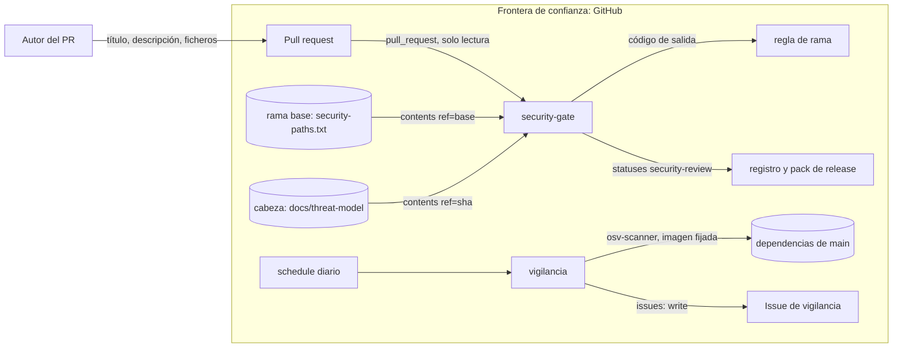

# Threat model — SMC-009 · Puerta de seguridad en PR y vigilancia diaria de dependencias

**Versión:** v1 · **Fecha:** 2026-11-07 · **Autor:** engineering (dev-proyecto, T51) · **Revisor:** independent-reviewer
**Issue:** #28 · **ADR relacionado:** n/a

Alcance: dos piezas. (A) `security-gate`: job de `pr-meta.yml` que ejecuta `scripts/change_evidence.py security --pr N`, con
la lista `.github/security-paths.txt`, el campo `security` del registro y el hueco del pack. (B) `vigilancia.yml` diario con
`scripts/vigilancia.py` y `issues: write` (tarea T52, con sus tests en `tests/test_vigilancia.py`).

## 1. Alcance y activos
| Activo | Clasificación (ENS: básica/media/alta) | Datos personales | Propietario |
|---|---|---|---|
| Integridad de la rama principal (qué código se fusiona) | media | no | David Moya |
| Lista `.github/security-paths.txt` y plantilla de threat model | media | no | David Moya |
| Registro de cambio y evidence pack (trazabilidad ante auditoría) | media | no | David Moya |
| Token `GITHUB_TOKEN` del job (lectura; en vigilancia, además `issues: write`) | media | no | David Moya |
| Issue `[vigilancia] vulnerabilidades en dependencias` | básica | no | David Moya |

## 2. Diagrama de flujo de datos

## 3. Amenazas (STRIDE)
| ID | Categoría | Amenaza | Componente | Prob. (1-3) | Impacto (1-3) | Riesgo | Mitigación | Test que la verifica | Estado |
|---|---|---|---|---|---|---|---|---|---|
| T1 | Tampering | El PR edita `security-paths.txt` (vaciándola o quitando su ruta) para librarse de la puerta | lectura de la lista | 2 | 3 | 6 | La lista se lee de la rama base, nunca de la cabeza; tocar la lista activa la puerta, también borrándola | `tests/test_change_evidence.py::test_puerta_decide_si_aplica[lista_de_la_cabeza_vaciada_no_libra]`, `tests/test_change_evidence.py::test_puerta_decide_si_aplica[lista_ampliada_en_la_cabeza_no_cuenta]`, `tests/test_change_evidence.py::test_puerta_decide_si_aplica[tocar_la_lista_activa_la_puerta]`, `tests/test_change_evidence.py::test_puerta_decide_si_aplica[borrar_la_lista_activa_la_puerta]` | mitigada |
| T2 | Tampering | El PR mueve un fichero sensible fuera de su ruta (renombrado) para no casar con la lista | filtro de rutas | 2 | 3 | 6 | Se comprueban `filename` y `previous_filename` de `pulls/N/files`; la lista de ficheros se lee entera y 3000 ficheros (tope de la API) es error | `tests/test_change_evidence.py::test_puerta_decide_si_aplica[renombrado_desde_ruta_sensible_aplica]`, `tests/test_change_evidence.py::test_modo_security[3000_ficheros_es_lectura_incompleta]` | mitigada |
| T3 | Spoofing | Una rama llamada `release-please--branches--*` (o un fork) para que el PR se tome por PR de release y se exima | exención de release | 2 | 3 | 6 | La exención exige mismo repositorio y que todos los ficheros sean de versión (`is_release_pr`) | `tests/test_change_evidence.py::test_puerta_decide_si_aplica[rama_de_release_con_otro_fichero_aplica]`, `tests/test_change_evidence.py::test_puerta_decide_si_aplica[rama_de_release_desde_un_fork_aplica]` | mitigada |
| T4 | Tampering | Línea `Threat model: no aplica:` escondida en un comentario HTML o con motivo vacío, o la plantilla del PR sin rellenar | descripción del PR | 3 | 2 | 6 | Se ignoran los comentarios HTML (también sin cerrar) y se exige motivo no vacío; la línea debe empezar la línea | `tests/test_change_evidence.py::test_exige_threat_model_o_linea_no_aplica_con_motivo`, `tests/test_change_evidence.py::test_exige_threat_model_o_linea_no_aplica_con_motivo[plantilla_del_pr_sin_rellenar_no_pasa]` | mitigada |
| T5 | Tampering | Threat model entregado sin hacer: plantilla intacta, vacío o sin filas de amenaza, estados fuera del vocabulario (`abierta (pendiente)`, `abierto`) o aceptaciones sin firmar | contenido del threat model | 3 | 2 | 6 | Se exige al menos una fila de amenaza, estado exactamente `mitigada` o `aceptada` (la celda entera), sin placeholders (comentarios HTML aparte) y, por cada `aceptada`, su fila en la sección 5 con «Fecha» con formato de fecha; si el fichero existe se juzga aunque haya línea de no aplicación | `tests/test_change_evidence.py::test_contenido_del_threat_model[la_plantilla_sin_rellenar_no_pasa]`, `tests/test_change_evidence.py::test_contenido_del_threat_model[sin_filas_de_amenaza_1]`, `tests/test_change_evidence.py::test_contenido_del_threat_model[estado_fuera_del_vocabulario_0]`, `tests/test_change_evidence.py::test_contenido_del_threat_model[estado_fuera_del_vocabulario_2]`, `tests/test_change_evidence.py::test_contenido_del_threat_model[aceptada_con_fecha_vacia_no_pasa]`, `tests/test_change_evidence.py::test_contenido_del_threat_model[una_fila_abierta_entre_cerradas]`, `tests/test_change_evidence.py::test_exige_threat_model_o_linea_no_aplica_con_motivo[si_existe_el_threat_model_se_juzga_aunque_haya_linea]` | mitigada |
| T6 | Tampering | Threat model de la rama base, de otra tarea o ya existente sin tocar presentado como el del cambio | lectura del threat model | 2 | 2 | 4 | Se lee de la cabeza del PR por SHA, debe estar añadido o modificado en `pulls/N/files` (un renombrado cuenta como tocado) y hace falta uno por cada TASK_ID del PR | `tests/test_change_evidence.py::test_exige_threat_model_o_linea_no_aplica_con_motivo[threat_model_solo_en_la_base_no_vale]`, `tests/test_change_evidence.py::test_exige_threat_model_o_linea_no_aplica_con_motivo[modelo_existente_en_la_cabeza_sin_tocar_no_vale]`, `tests/test_change_evidence.py::test_exige_threat_model_o_linea_no_aplica_con_motivo[task_de_otra_tarea_con_modelo_existente_no_vale]`, `tests/test_change_evidence.py::test_exige_threat_model_o_linea_no_aplica_con_motivo[modelo_renombrado_cuenta_como_tocado]`, `tests/test_change_evidence.py::test_exige_threat_model_o_linea_no_aplica_con_motivo[varias_tareas_cada_una_necesita_el_suyo]` | mitigada |
| T7 | Denial of service | La API de GitHub falla o devuelve un 403 y la puerta pasa en abierto | lectura de la API | 2 | 3 | 6 | Cualquier fallo de lectura sale con 1; solo un 404 del fichero es ausencia (lista ausente: solo cuenta el tipo `sec`, con aviso); carpetas, enlaces y ficheros grandes son error | `tests/test_change_evidence.py::test_modo_security`, `tests/test_change_evidence.py::test_modo_security[403_en_la_lista_no_es_lista_ausente]`, `tests/test_change_evidence.py::test_leer_fichero_distingue_ausencia_de_error` | mitigada |
| T8 | Elevation of privilege | `pull_request_target` o datos del PR interpolados en el shell: código de un fork con secretos o inyección por título | `pr-meta.yml` | 2 | 3 | 6 | Solo `pull_request`, permisos de lectura, acciones fijadas por SHA, sin credenciales persistidas y número de PR por variable de entorno | `tests/test_change_evidence.py::test_workflow_security_gate_y_lista_de_rutas[usa_pull_request_y_nunca_pull_request_target]`, `tests/test_change_evidence.py::test_workflow_security_gate_y_lista_de_rutas[no_interpola_datos_del_pr_en_el_shell]`, `tests/test_change_evidence.py::test_workflow_security_gate_y_lista_de_rutas[actions_fijadas_por_sha_y_sin_credenciales_persistidas]`, `tests/test_change_evidence.py::test_workflow_security_gate_y_lista_de_rutas[no_pide_mas_permisos_que_lectura]` | mitigada |
| T9 | Repudiation | Un `security-review` publicado después del merge se cuenta como revisión previa; o un PR que activa la puerta se fusiona sin él | registro y pack | 2 | 2 | 4 | El estado se corta en `merged_at` como `blind-review`; el pack anota hueco si la puerta aplica y el estado no es `success` | `tests/test_change_evidence.py::test_registro_con_campo_security[security_review_posterior_al_merge_no_cuenta]`, `tests/test_change_evidence.py::test_pack_de_release_anota_el_hueco_de_security_review[aplica_sin_security_review_deja_hueco]`, `tests/test_change_evidence.py::test_pack_de_release_anota_el_hueco_de_security_review[security_review_solo_posterior_al_merge_deja_hueco]` | mitigada |
| T10 | Information disclosure | El token del job se filtra por el registro o por el log | `GITHUB_TOKEN` | 1 | 2 | 2 | El script no imprime el entorno ni el token; el token es de solo lectura y no se persiste en `.git` | `tests/test_change_evidence.py::test_workflow_security_gate_y_lista_de_rutas[no_pide_mas_permisos_que_lectura]`, `tests/test_change_evidence.py::test_workflow_security_gate_y_lista_de_rutas[actions_fijadas_por_sha_y_sin_credenciales_persistidas]` | mitigada |
| T11 | Tampering | Un PR modifica `change_evidence.py` o `pr-meta.yml` para que la puerta pase: con `pull_request` el job ejecuta la versión del propio PR | job `security-gate` | 2 | 3 | 6 | Ambos ficheros están en la lista, así que el cambio exige threat model y revisión ciega; el job debe entrar en la regla de rama (la añade David tras fusionar) | `tests/test_change_evidence.py::test_workflow_security_gate_y_lista_de_rutas[la_lista_de_rutas_sensibles_del_repositorio]` | aceptada |
| T13 | Spoofing | Un motivo libre de `no aplica` que no es cierto en un PR sensible | descripción del PR | 3 | 2 | 6 | Queda en el registro (`threat_model`: `no aplica: motivo`) y lo ve la revisión ciega | `tests/test_change_evidence.py::test_registro_con_campo_security[recoge_la_linea_no_aplica]` | aceptada |
| T14 | Elevation of privilege | `vigilancia.yml` con `issues: write` procesa la salida de `osv-scanner`, con nombres de paquete y textos que controlan terceros | job de vigilancia | 2 | 2 | 4 | Permisos mínimos (`contents: read`, `issues: write`); el cuerpo de la issue va por stdin y nunca por argumento; el token entra por variable de entorno y no se interpola nada en el shell | `tests/test_vigilancia.py::test_permisos_minimos`, `tests/test_vigilancia.py::test_run_no_interpola_expresiones`, `tests/test_vigilancia.py::test_cuerpo_va_por_stdin_no_por_argumento`, `tests/test_vigilancia.py::test_workflow_gh_usa_token_por_entorno` | mitigada |
| T15 | Tampering | La vigilancia usa una imagen de `osv-scanner` distinta de la de `sca`, o sigue una etiqueta móvil | job de vigilancia | 2 | 2 | 4 | La vigilancia usa la misma imagen, con versión y digest, que `sca` de `ci.yml`; un test compara las dos | `tests/test_vigilancia.py::test_misma_imagen_osv_que_ci`, `tests/test_vigilancia.py::test_imagen_osv_con_version_y_digest` | mitigada |
| T16 | Denial of service | Un fallo del escáner se toma por «sin hallazgos» y cierra la issue, o se duplica la issue en cada ejecución | job de vigilancia | 2 | 3 | 6 | Un error del escáner (código ajeno a 0, 1 y 128, o JSON ilegible) deja el job en rojo sin tocar ninguna issue; antes de crear se busca la abierta y no se duplica | `tests/test_vigilancia.py::test_error_del_escaner_rojo_y_no_toca_issues`, `tests/test_vigilancia.py::test_error_del_escaner_no_crea_issue`, `tests/test_vigilancia.py::test_hallazgos_busca_la_abierta_antes_de_crear`, `tests/test_vigilancia.py::test_hallazgos_dos_veces_no_duplica`, `tests/test_vigilancia.py::test_workflow_no_traga_el_codigo_del_escaner` | mitigada |
| T17 | Tampering | Un nombre de rama con `&`, `#` o `?` altera la consulta `contents?ref=` y la puerta lee otro fichero u otra versión | lectura de ficheros | 2 | 3 | 6 | `ref` y ruta se escapan antes de montar la URL; la consulta lleva solo `ref` | `tests/test_change_evidence.py::test_leer_fichero_escapa_ref_y_ruta` | mitigada |

## 4. Si hay LLM o tool-calling
No hay LLM ni tool-calling en ninguna de las dos piezas.

## 5. Riesgos aceptados
La firma es la columna «Fecha»: la rellena David Moya al aceptar el riesgo. Vacía, la puerta no deja pasar este modelo.

| ID | Justificación | Aceptado por | Fecha | Revisar en |
|---|---|---|---|---|
| T11 | Un workflow `pull_request` siempre corre la versión del PR; la defensa es la lista, la revisión ciega y el job requerido en la regla de rama | David Moya |  | al añadir `security-gate` a la regla de rama |
| T13 | El motivo es texto libre y queda en el registro para auditoría | David Moya |  | tras 10 PR con la puerta |

**Done when:** toda amenaza con riesgo ≥ 4 tiene mitigación + test, o una fila en §5.
