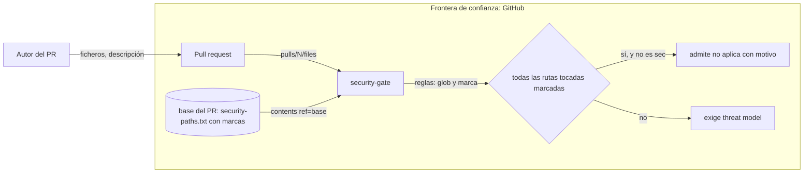

# Threat model — SMC-011 · Rutas que admiten «no aplica» configurables con `~`

**Versión:** v2 · **Fecha:** 2026-11-07 · **Autor:** engineering (dev-proyecto, T57) · **Revisor:** independent-reviewer
**Issue:** #33 · **ADR relacionado:** n/a

Alcance: la puerta `security-gate` (SMC-009) decidía con una constante del script (`NO_APLICA_PREFIX`) en qué rutas sensibles valía
`Threat model: no aplica`. Ahora lo decide la lista `.github/security-paths.txt`: un `~` pegado al inicio de la ruta la marca (sigue
siendo sensible y además admite «no aplica»). «No aplica» solo vale si todas las rutas sensibles tocadas, también por el origen de un
renombrado, casan con rutas marcadas y con ninguna sin marcar, y nunca en un PR de tipo `sec`. Sin ninguna marca no vale en ninguna ruta.
La marca se lee de la lista de la rama base, como el resto de la lista. En SMC llevan la marca las cuatro rutas que antes salían por el
prefijo. Componentes: `parse_security_rules` y `_evaluate_security` de `scripts/change_evidence.py`, la lista y la plantilla del PR.
No hay datos personales ni LLM. El modelo de la puerta en su conjunto sigue siendo `docs/threat-model/SMC-009.md`.

## 1. Alcance y activos
| Activo | Clasificación (ENS: básica/media/alta) | Datos personales | Propietario |
|---|---|---|---|
| Lista `.github/security-paths.txt` con sus marcas `~` | media | no | David Moya |
| Decisión de la puerta sobre qué cambios admiten «no aplica» | media | no | David Moya |
| Plantilla del PR (`.github/pull_request_template.md`) | básica | no | David Moya |

## 2. Diagrama de flujo de datos

## 3. Amenazas (STRIDE)
| ID | Categoría | Amenaza | Componente | Prob. (1-3) | Impacto (1-3) | Riesgo | Mitigación | Test que la verifica | Estado |
|---|---|---|---|---|---|---|---|---|---|
| T1 | Tampering | El PR marca con `~` una ruta sensible en la lista para librarse del modelo, o la marca en la cabeza y no en la base | lectura de la lista | 2 | 3 | 6 | La lista y sus marcas se leen de la base del PR, nunca de la cabeza; tocar la lista activa la puerta en modo estricto aunque la ruta quede marcada (el test simula la cabeza con `~scripts/*` y la base sin marcas) | `tests/test_change_evidence.py::test_t57_marcar_una_ruta_en_la_cabeza_no_libra_la_marca_se_lee_de_la_base`, `tests/test_change_evidence.py::test_t57_tocar_la_lista_sigue_siendo_estricto_aunque_este_marcada`, `tests/test_change_evidence.py::test_t57_marcar_una_ruta_sensible_para_librarse_del_modelo_exige_modelo` | mitigada |
| T2 | Tampering | Una marca mal escrita (`~ ruta`, `~~ruta`, `~` seguido de un espacio Unicode como NBSP o U+3000) se toma por glob literal y la ruta deja de ser sensible, o se toma por marca válida; o un signo parecido a `~` (`～`, `˜`) o un glob con espacios internos o `./` no casa nunca | `parse_security_rules` | 2 | 3 | 6 | Una marca mal escrita (incluido `~` seguido de NBSP o U+3000) no marca: la ruta queda sensible y sin exención; se quitan del inicio los `~` y todo espacio Unicode y la ruta queda sensible y sin exención; el `~` nunca forma parte del glob. Los signos parecidos (`～`, `˜`) no se tratan como marca: el glob queda tal cual y la puerta avisa (`AVISO`) de globs con caracteres no ASCII, que empiezan por `./` o con espacios internos, sin cambiar la decisión | `tests/test_change_evidence.py::test_t57_una_marca_mal_escrita_no_marca_y_la_ruta_sigue_siendo_sensible`, `tests/test_change_evidence.py::test_t57_parse_security_rules`, `tests/test_change_evidence.py::test_t57_parse_security_paths_quita_la_marca_y_no_la_trata_como_glob`, `tests/test_change_evidence.py::test_t58_espacios_unicode_tras_la_marca_se_quitan_y_la_ruta_queda_sensible_sin_marca`, `tests/test_change_evidence.py::test_t58_otros_signos_parecidos_a_la_marca_no_marcan_y_se_avisan`, `tests/test_change_evidence.py::test_t58_globs_sospechosos_dan_aviso_sin_cambiar_la_decision`, `tests/test_change_evidence.py::test_t58_el_aviso_sale_por_la_salida_de_la_puerta` | mitigada |
| T3 | Elevation of privilege | Un PR mezcla una ruta marcada con otra sin marcar, o la ruta casa con una regla marcada y con otra sin marcar, o el origen de un renombrado es una ruta sin marcar, para que «no aplica» valga | `_evaluate_security` | 2 | 3 | 6 | «No aplica» exige que cada ruta sensible tocada (nombre actual y origen del renombrado) case con una regla marcada y con ninguna sin marcar; una sola que falle exige el modelo | `tests/test_change_evidence.py::test_t57_una_ruta_marcada_y_otra_sin_marcar_no_valen`, `tests/test_change_evidence.py::test_t57_una_ruta_que_casa_con_una_marcada_y_otra_sin_marcar_no_vale`, `tests/test_change_evidence.py::test_t57_el_origen_de_un_renombrado_tambien_cuenta` | mitigada |
| T4 | Elevation of privilege | «No aplica» en un PR de tipo `sec`, o en una lista sin ninguna marca (por ejemplo una marca escrita dentro de un comentario), o en una ruta marcada que además es la propia puerta (`scripts/change_evidence.py`) o un workflow | motivo de «no aplica» | 2 | 3 | 6 | Un PR `sec` nunca admite «no aplica»; sin marcas no vale en ninguna ruta; un `~` dentro de un comentario no marca; la lista, `change_evidence.py` y los workflows siguen siendo estrictos | `tests/test_change_evidence.py::test_t57_en_un_pr_sec_no_aplica_no_vale_aunque_todo_este_marcado`, `tests/test_change_evidence.py::test_t57_lista_sin_ruta_marcada_no_admite_no_aplica`, `tests/test_change_evidence.py::test_t58_con_la_base_marcada_scripts_change_evidence_exige_modelo`, `tests/test_change_evidence.py::test_t58_con_la_base_marcada_github_un_workflow_exige_modelo`, `tests/test_change_evidence.py::test_t58_con_la_base_marcada_scripts_otro_fichero_si_admite_no_aplica`, `tests/test_change_evidence.py::test_t58_con_la_base_marcada_github_otro_fichero_si_admite_no_aplica` | mitigada |
| T5 | Tampering | Regresión en SMC: tras sacar el prefijo del script, las rutas de `smc/` dejan de admitir «no aplica», o las de fuera de `smc/` empiezan a admitirlo | lista y puerta | 2 | 2 | 4 | Las cuatro rutas de `smc/` llevan la marca en la lista real y solo ellas; el script no contiene `smc/` ni la constante; el resto de la lista sigue exigiendo el modelo | `tests/test_change_evidence.py::test_t57_la_lista_real_marca_solo_las_cuatro_rutas_de_smc`, `tests/test_change_evidence.py::test_t57_en_smc_el_comportamiento_no_cambia_con_la_lista_real`, `tests/test_change_evidence.py::test_t57_la_lista_real_sigue_exigiendo_modelo_fuera_de_smc`, `tests/test_change_evidence.py::test_t57_el_script_no_nombra_a_smc_ni_guarda_el_prefijo` | mitigada |
| T6 | Repudiation | La lista o la plantilla describen otra regla distinta de la que aplica el script, y quien las lee acepta un cambio sin saberlo | documentación de la regla | 2 | 2 | 4 | El comentario de la lista y la plantilla explican la marca `~` sin nombrar rutas de un proyecto; un test comprueba que lo dicen y que no nombran `smc/` | `tests/test_change_evidence.py::test_t57_la_lista_y_la_plantilla_describen_la_marca_sin_nombrar_smc` | mitigada |

La suplantación de la marca por la cabeza del PR, el robo de información y la denegación de servicio no añaden nada a lo ya cubierto
en SMC-009 (T1, T7 y T17): este cambio no lee nada nuevo de la API ni escribe estados.

## 4. Si hay LLM o tool-calling
No hay LLM ni tool-calling.

## 5. Riesgos aceptados
Ninguno: toda amenaza de este modelo está mitigada con test. Los riesgos aceptados de la puerta siguen en SMC-009.
