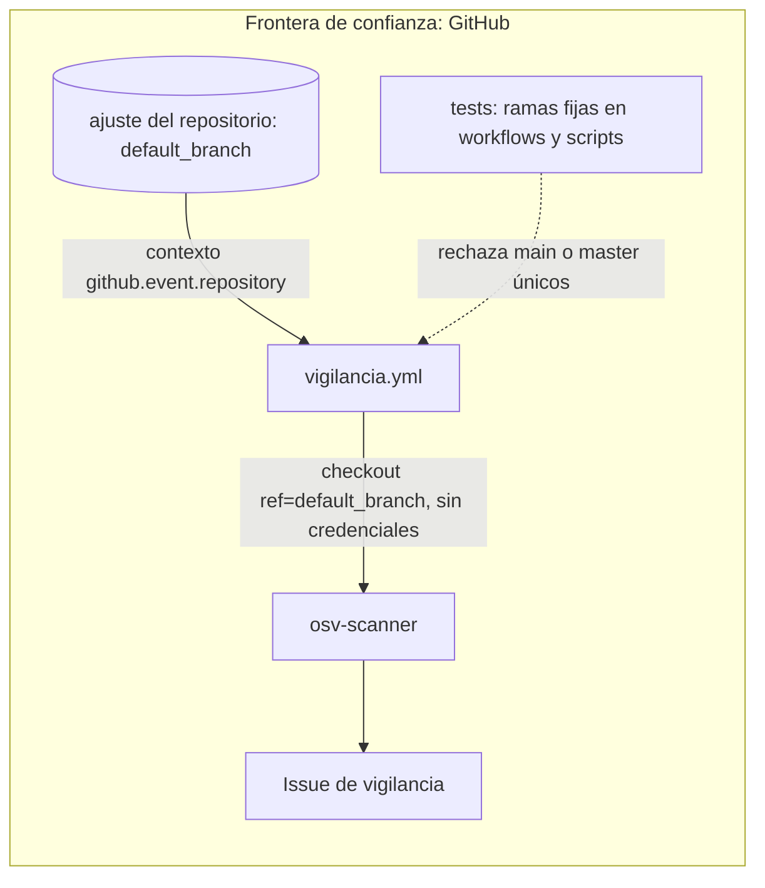

# Threat model — SMC-012 · La vigilancia hace checkout de la rama por defecto

**Versión:** v1 · **Fecha:** 2026-11-08 · **Autor:** engineering (dev-proyecto, T59) · **Revisor:** independent-reviewer
**Issue:** #36 · **ADR relacionado:** n/a

Alcance: `.github/workflows/vigilancia.yml` hacía checkout con `ref: main` fijo. En un repositorio cuya rama por defecto es otra (MalwareIntel: `master`)
el job falla, o escanea una rama `main` que no es la que se fusiona. Ahora el checkout usa `ref: ${{ github.event.repository.default_branch }}`.
Además, dos tests recorren `.github/workflows/*.yml` y `scripts/*.py` y rechazan un `ref` o unos `branches` que fijen una sola rama `main` o `master`
(se admiten `[main, master]`, la rama por defecto y la etiqueta de release de `release.yml`). `tests.yml` fija `branches: [main]` y esta tarea no lo toca:
queda en una lista de excepciones del test, que falla en cuanto deje de hacer falta. No cambian permisos, datos ni `vigilancia.py`.
No hay datos personales ni LLM.

## 1. Alcance y activos
| Activo | Clasificación (ENS: básica/media/alta) | Datos personales | Propietario |
|---|---|---|---|
| Cobertura de la vigilancia diaria (qué rama de dependencias se escanea) | media | no | David Moya |
| Workflow `vigilancia.yml` (checkout con `contents: read`, sin credenciales persistidas) | media | no | David Moya |

## 2. Diagrama de flujo de datos

## 3. Amenazas (STRIDE)
| ID | Categoría | Amenaza | Componente | Prob. (1-3) | Impacto (1-3) | Riesgo | Mitigación | Test que la verifica | Estado |
|---|---|---|---|---|---|---|---|---|---|
| T1 | Denial of service | Con la rama fija y otra rama por defecto, el checkout falla o escanea una rama `main` abandonada: la vigilancia deja de ver las dependencias reales sin avisar | checkout de `vigilancia.yml` | 2 | 3 | 6 | El checkout usa `github.event.repository.default_branch`, la rama que se fusiona; un test lee el YAML y lo exige | `tests/test_vigilancia.py::test_t59_el_checkout_de_la_vigilancia_usa_la_rama_por_defecto`, `tests/test_vigilancia.py::test_workflow_escanea_la_rama_principal_y_llama_al_script` | mitigada |
| T2 | Elevation of privilege | La expresión de la rama se interpola en el shell y un nombre de rama con metacaracteres ejecuta comandos | pasos del job | 1 | 3 | 3 | La expresión va solo en `with:` del checkout, no en ningún `run`; ningún `run` interpola `${{ }}`; el job sigue con `contents: read` e `issues: write` y sin credenciales persistidas | `tests/test_vigilancia.py::test_run_no_interpola_expresiones`, `tests/test_vigilancia.py::test_permisos_minimos`, `tests/test_vigilancia.py::test_t59_el_checkout_de_la_vigilancia_usa_la_rama_por_defecto` | mitigada |
| T3 | Tampering | Regresión: alguien vuelve a fijar `main` o `master` en un `ref` o en `branches` de un workflow o de un script y el fallo reaparece en otro repositorio | workflows y scripts | 2 | 2 | 4 | Dos tests recorren `.github/workflows/*.yml` (por YAML, sin contar comentarios) y `scripts/*.py` y rechazan una rama fija única; no rechazan `[main, master]`, la rama por defecto ni la etiqueta de `release.yml`; la excepción de `tests.yml` falla en cuanto se arregle | `tests/test_vigilancia.py::test_t59_ningun_workflow_fija_una_sola_rama_salvo_la_excepcion_conocida`, `tests/test_vigilancia.py::test_t59_ningun_script_fija_una_sola_rama`, `tests/test_vigilancia.py::test_t59_la_excepcion_de_tests_yml_sigue_haciendo_falta`, `tests/test_vigilancia.py::test_t59_detector_de_rama_fija_en_yaml`, `tests/test_vigilancia.py::test_t59_detector_de_rama_fija_en_python` | mitigada |

Spoofing, repudio y fuga de información no cambian: el cambio no lee ni escribe nada nuevo y la rama por defecto la fija quien administra el
repositorio (el mismo que ya controla el workflow). Queda fuera de alcance `tests.yml` con `branches: [main]`, que es de CI de tests y no de la vigilancia.

## 4. Si hay LLM o tool-calling
No hay LLM ni tool-calling.

## 5. Riesgos aceptados
Ninguno. El modelo de la puerta y los riesgos aceptados de la vigilancia siguen en `docs/threat-model/SMC-009.md`.
