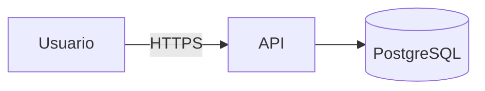

# Threat model — <TASK_ID> · <feature>

**Versión:** v1 · **Fecha:** YYYY-MM-DD · **Autor:** engineering · **Revisor:** independent-reviewer
**Issue:** #<n> · **ADR relacionado:** docs/adr/NNNN-<slug>.md

## 1. Alcance y activos
| Activo | Clasificación (ENS: básica/media/alta) | Datos personales | Propietario |
|---|---|---|---|
|  |  | sí / no |  |

## 2. Diagrama de flujo de datos

## 3. Amenazas (STRIDE)
| ID | Categoría | Amenaza | Componente | Prob. (1-3) | Impacto (1-3) | Riesgo | Mitigación | Test que la verifica | Estado |
|---|---|---|---|---|---|---|---|---|---|
| T1 | Spoofing |  |  |  |  |  |  | `tests/...::test_...` | abierta |
| T2 | Tampering |  |  |  |  |  |  |  |  |
| T3 | Repudiation |  |  |  |  |  |  |  |  |
| T4 | Information disclosure |  |  |  |  |  |  |  |  |
| T5 | Denial of service |  |  |  |  |  |  |  |  |
| T6 | Elevation of privilege |  |  |  |  |  |  |  |  |

## 4. Si hay LLM o tool-calling (añadir)
| ID | Amenaza | Mitigación | Caso en `evals/security/` |
|---|---|---|---|
| L1 | Prompt injection indirecta (documento/URL/log) |  |  |
| L2 | Exfiltración vía tool-calling |  |  |
| L3 | Salida no validada usada como comando/SQL |  |  |
| L4 | Fuga entre tenants por contexto/RAG |  |  |

## 5. Riesgos aceptados
| ID | Justificación | Aceptado por | Fecha | Revisar en |
|---|---|---|---|---|
|  |  | David Moya |  |  |

**Done when:** toda amenaza con riesgo ≥ 4 tiene mitigación + test, o una fila en §5.
